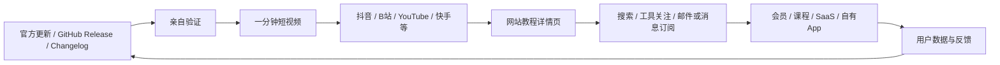
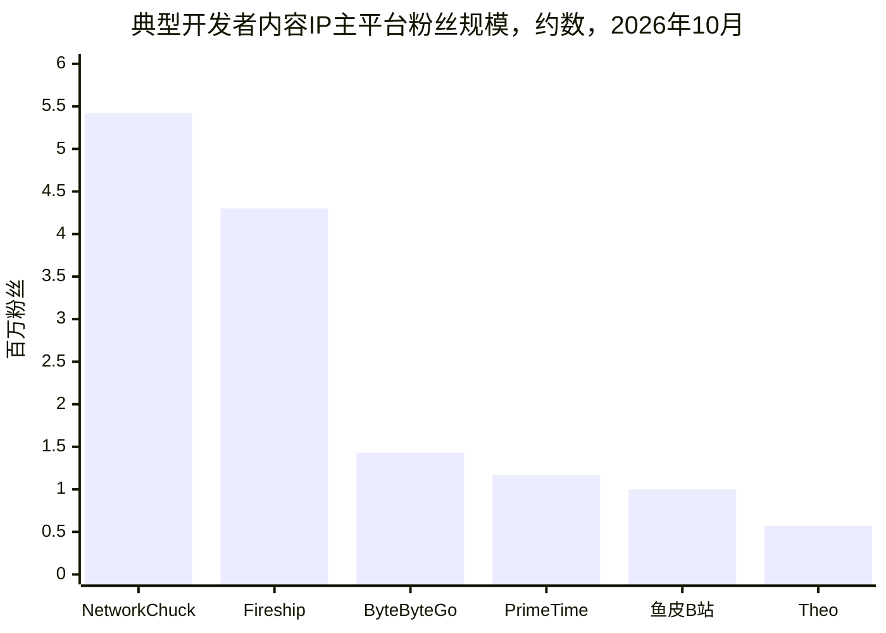
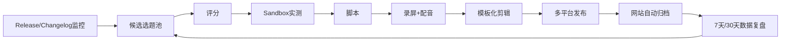
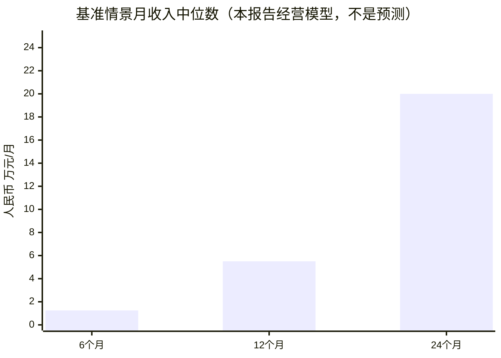

# 面向软件开发者的「一分钟工具情报 + 可检索知识库」IP 可行性研究

## 执行摘要

**结论：值得做，综合可行性约为 7.8/10；但真正有长期价值的项目，不应被定义成“程序员短视频账号”，而应定义成“经过实测验证的开发者工具情报数据库 + 短视频分发网络”。**

这两种定位的商业价值差异很大。

单纯做「Codex 又更新了什么」「VS Code 新功能来了」的账号，进入门槛低、信息保质期短，而且 AI 已经能快速总结 changelog，长期很容易同质化。更有防御力的模式是：

> **发现新功能 → 亲自验证 → 60 秒告诉开发者它解决什么问题 → 网站保存版本、命令、配置、官方出处、适用场景和坑 → 用户关注具体工具 → 最终通过赞助、会员、自有软件/SaaS 变现。**

这个方向恰好踩中了当前开发者内容市场的两个趋势：一方面，开发者使用 AI 和各种新工具的频率大幅提高；另一方面，对结果是否可信、是否能够验证的要求也更高。Stack Overflow 2026 Developer Survey 显示，约 80% 的受访开发者每天至少使用 AI 一小时；与此同时，开发者对 AI 输出的信任仍明显依赖“能否轻松验证”，而引用可靠来源被绝大多数受访者认为重要。该调查是全球开发者样本，并不等同于中国开发者总体，但非常适合作为这个内容方向的趋势信号。citeturn6search10 GitHub 的开发生态也在继续快速向 AI Coding、Agent、CLI 与自动化工作流扩展，其公开数据已经显示大量 AI 项目和 LLM SDK 使用增长。citeturn6search1turn6search13

因此，你的核心竞争力不应该是：

> “我知道一个新功能。”

而应该是：

> **“我比大多数中文开发者更早发现，并且已经替你验证过：它到底有没有用、适用于哪个版本、怎么打开、有什么坑。”**

建议第一阶段聚焦 **AI Coding + IDE + CLI + Git/GitHub + 浏览器开发工具 + DevOps 工具**，不要一开始覆盖整个软件开发世界。目标受众首先是已经工作的开发者，而不是零基础学编程用户。后者规模大，但商业价值、工具付费意愿和对“新功能”的即时需求通常低于职业开发者。

建议使用一句非常明确的品牌承诺：

> **「一分钟发现一个真正能提高开发效率的功能；全部亲自验证，完整命令、版本和官方来源可搜索。」**

商业上，这个领域已经有充分的可行性证据：Fireship、NetworkChuck、ByteByteGo、Theo 等开发者频道已经分别证明了“高密度技术内容”“人格化教程”“内容→课程”“开发者工具赞助”等模式；中国的程序员鱼皮则证明了中文编程内容可以进一步连接社区、教程、网站以及自有产品。citeturn22view0turn21view1turn22view2turn20search0turn22view3

但要特别注意：**短视频本身不应是最终产品，而是获客渠道。**

建议建立如下飞轮：



按本报告的模型评估：

| 维度 | 评分 | 关键判断 |
|---|---:|---|
| 市场需求 | 8.5/10 | 开发工具和 AI Coding 更新速度极快 |
| 选题供给 | 9.0/10 | 基本不存在“没有内容可做”的问题 |
| 差异化难度 | 6.5/10 | 单纯新闻很容易被复制 |
| 单人执行可行性 | 7.5/10 | 模板化后可做到每周 3–5 条 |
| 商业价值 | 8.0/10 | Developer SaaS 广告主价值较高，自有软件匹配度更高 |
| 长期壁垒 | 7.5/10 | 视频弱、结构化数据库强 |
| **综合判断** | **约 7.8/10** | **建议启动，但网站从第一天就应纳入体系** |

最大的战略错误会是：**前三个月花大量时间做 APP，而不是生产 50–80 个经过验证的教程。**

网站 MVP 足够；原生 APP 应等到你已经证明用户确实有“订阅某个工具更新”“收藏教程”“跨设备查命令”等高频需求之后再做。

## 市场需求、目标用户与核心痛点

以中文受众为主时，我建议不要把目标用户定义成宽泛的“程序员”，而分成四层。

| 用户类型 | 大致阶段 | 最关注的问题 | 内容需求 | 商业价值 | 优先级 |
|---|---|---|---|---:|---:|
| 职业开发者 | 1–8 年经验 | 怎样少写代码、少踩坑、提高效率 | IDE、CLI、AI Coding、Git、Debug、DevOps | 很高 | **P0** |
| AI Native Developer / 独立开发者 | 有产品实践 | 哪个 Agent/模型/工具真正能生产 | Codex、Claude Code、Copilot、Agent、自动化 | 很高 | **P0** |
| 学生/初级程序员 | 学习、求职 | 什么工具值得学、怎么使用 | IDE、Git、CLI、框架基础 | 中 | P1 |
| Tech Lead / 架构师 | 中高级 | 新工具是否值得团队采用 | 对比、成本、安全、迁移、生产实践 | 很高但规模较小 | P1 |

**真正值得争夺的核心用户是前两类。**

这批人的问题通常不是“完全不会用 VS Code”，而是：

> “我每天都在用 VS Code，但不知道最近半年又出现了哪些能帮我节省时间的功能。”

或者：

> “Codex/Claude Code/Cursor 每周都在变化，我根本没时间把 release notes 全部读完。”

再或者：

> “X 上有人说这个功能神奇，但它在真实项目里到底能不能用？”

Stack Overflow 2026 的调查尤其说明了“验证”为什么应该成为你的品牌差异点：开发者已经大量使用 AI，但是否信任答案高度取决于是否能够验证，可靠来源又被高度重视。citeturn6search10

因此用户需求的优先顺序建议是：

| 优先级 | 用户需求 | 应提供的产品能力 |
|---|---|---|
| **P0** | 帮我过滤海量更新 | 只推真正有用的新功能 |
| **P0** | 告诉我到底有没有用 | 真人/真实项目验证 |
| **P0** | 让我一分钟理解 | Before → After 演示 |
| **P0** | 让我立即复制使用 | 命令、配置、快捷键、代码 |
| **P1** | 告诉我哪个版本可用 | version / OS / IDE 标注 |
| **P1** | 以后还能找到 | 网站搜索、标签、工具目录 |
| **P1** | 更新了主动告诉我 | “关注 VS Code / Codex / Git”式订阅 |
| **P2** | 帮我决定是否迁移/付费 | 工具横评、成本与局限 |
| **P2** | 和其他开发者交流 | 评论、社区、案例投稿 |

网站也因此不能只是“视频列表”。

每篇教程至少应该存储：

`tool`、`feature`、`version`、`OS`、`IDE`、`release_date`、`verified_at`、`difficulty`、`use_case`、`commands`、`official_source`、`limitations`、`video_url`、`transcript`、`related_features`。

最关键的字段之一是：

**Verified on：2026-10-15**

甚至可以设计“新鲜度”：

- 绿色：最近 90 天验证；
- 黄色：90–180 天未复核；
- 红色：版本已变化或超过复核周期。

这将产生一个普通短视频账号没有的资产：**可信的开发工具知识数据库。**

长期来看，你卖的不一定只是教程，而可以是：

> “开发者工具的 Bloomberg / Product Hunt + Manual + Changelog Digest。”

这是比“程序员博主”更有想象空间的定位。

## 竞品与类似 IP：什么已经被证明有效

截至 2026 年 10 月中旬，开发者内容赛道已经出现多个非常有代表性的商业模型。以下粉丝数以公开页面或第三方统计平台最近数据为准，因此应视为近似值而非财务审计数据。

Fireship 约 430 万 YouTube 订阅；NetworkChuck 约 542 万；ByteByteGo 约 143 万 YouTube 订阅、跨 YouTube/Instagram/TikTok 约 210 万；Theo - t3.gg 约 57.2 万；The PrimeTime 约 117 万；程序员鱼皮则在 2026 年取得 B 站百万粉丝奖牌，并自述全网累计超过 200 万粉丝。citeturn22view0turn21view1turn22view2turn21view3turn22view1turn18search0turn22view3



| IP / 渠道 | 主阵地与粉丝量 | 公开内容频率 | 核心内容 | 主要变现 | 优势 | 对本项目的启示 |
|---|---|---|---|---|---|---|
| **Fireship** | YouTube ≈ **430 万** citeturn22view0 | 2026 年 10 月观察约数条/周；10 月 2–8 日公开统计出现 3 次新增视频 citeturn22view0 | 快节奏编程新闻、框架、AI、100 秒式解释 | Fireship Pro 课程、赞助、平台收入；官方站点长期经营付费课程库 citeturn1search29 | 信息密度极高、幽默、人格化、节奏快 | **与你最接近。证明“开发者 + 极短内容”本身成立，但必须有强包装** |
| **NetworkChuck** | YouTube ≈ **542 万**，全平台约 680 万 citeturn21view1 | YouTube 约 **2.3 条/周** citeturn21view1 | Linux、网络、安全、CLI、IT 实验教程 | 赞助、品牌合作、培训相关商业化；2026 年公开合作包括 Hostinger、OpenAI 等 citeturn21view1 | 极强人格、演示感、非纯讲课 | 工具内容需要“让我现在就想试”的情绪，而不只是正确 |
| **ByteByteGo** | YouTube ≈ **143 万**；跨三平台约 210 万 citeturn22view2 | 当前约 **0.5 条 YouTube/周**；创立首年曾做到 52 周 52 条 citeturn22view2turn14search3 | 系统设计、架构、AI、图解 | 图书、付费课程、Live Cohort、赞助 citeturn14search23turn14search10 | 视觉识别极强，内容天然可沉淀 | **证明内容→知识库/课程是比单纯广告更强的路径** |
| **Theo - t3.gg** | YouTube ≈ **57.2 万** citeturn21view3 | 2026 年 10 月上半月约 5 条/周量级 citeturn21view3 | 新框架、AI Coding、开发者工具评价、行业观点 | 大量 Developer SaaS 赞助、自有 T3 产品、Affiliate | 受众商业价值极高；Theo 官方称频道每月超 300 万播放、常超 40 万小时观看，76% 观众年龄超过 25 岁，并已服务 40 多个品牌 citeturn20search0turn20search2 | **证明开发者工具测评是非常天然的 B2B SaaS 广告位** |
| **The PrimeTime** | YouTube ≈ **117 万** citeturn22view1 | 已发布约 2,220 条视频；自 2021 年以来历史平均约 7–8 条/周 citeturn22view1 | 技术新闻、反应、编程文化、行业评论 | 平台流量、频道生态等 | 高频、强人格、热点响应快 | 高频评论容易涨粉，但**搜索资产和教程复用价值低于结构化教程** |
| **程序员鱼皮** | B站已达到 **100 万**；自述全网 **200 万+** citeturn18search0turn22view3 | 热点驱动且高频；2026 年 9 月公开内容中连续出现 AI 模型、新工具、Codex 类实测 citeturn21view4 | AI 编程、开发教程、项目、求职、工具 | 付费编程社群、编程导航、自研产品、教程等 citeturn18search9 | 中文语境强、IP人格强、产品闭环强 | **最直接证明中文“内容→网站→社区→产品”路径可行** |

鱼皮本人还公开复盘过：最早做程序员面试短视频时，第一个视频花三四个小时、只有 18 次播放，随后坚持一个多月每天更新；后来开始多平台分发，并长期积累内容，最终形成 200 万+粉丝规模。这个案例的重要信息不是“日更一定成功”，而是开发者内容需要大量实验才能找到有效包装。citeturn22view3

从这些竞品可以得到一个很重要的市场空位：

**中文市场并不缺“编程博主”，但仍然缺一个足够系统化的“开发者工具功能数据库型 IP”。**

尤其可以避开：

> 编程入门  
> 算法刷题  
> Java 学习路线  
> AI 新闻搬运

而集中占领：

> **「你每天都在用的开发工具，还有哪些你不知道的能力？」**

这更容易形成明确心智。

内容形式建议融合三个标杆：

**Fireship 的速度 + Theo 的工具敏感度 + ByteByteGo 的知识沉淀。**

而商业闭环则更接近：

**程序员鱼皮：内容流量 → 自有网站 → 用户关系 → 自有产品。**

## 内容选题体系、发现机制与生产流程

你的最大问题不会是“没选题”，而会迅速变成：

> **每天出现 30 个更新，到底哪一个值得占用观众 60 秒？**

因此应该建立“选题雷达”，而不是依赖临时刷 X、B站或公众号。

GitHub 本身允许用户对仓库单独订阅 Releases 通知，因此对于 VS Code、框架、CLI、数据库和开源工具，可以建立非常高效的 Release Watchlist。citeturn7search0turn7search12

推荐将信息源按可信程度分层：

| 层级 | 来源 | 用法 |
|---|---|---|
| **S 级** | 官方 Changelog / Release Notes / Docs What's New | 最主要事实源 |
| **S 级** | GitHub Releases / PR / Commit | 开源项目第一手证据 |
| **A 级** | 官方 Product Blog / Engineering Blog | 产品背景、设计动机 |
| **A 级** | Marketplace / Package Registry 更新 | 插件、库、CLI |
| **B 级** | 官方开发者 X / LinkedIn / Discord | 发现尚未广泛传播的功能 |
| **C 级** | Hacker News / Reddit / X / B站 / 知乎 | 发现热点，不作为最终事实来源 |
| **D 级** | AI 自动摘要/二手自媒体 | 只能提供线索 |

建议维护约 **30–50 个重点产品**，而不是监控数千个项目。

第一批可以覆盖：

**AI Coding**：Codex、GitHub Copilot、Claude Code、Cursor、Windsurf 等。

**IDE / 编辑器**：VS Code、JetBrains 系列、Neovim。

**Terminal / CLI**：Git、GitHub CLI、fzf、ripgrep、jq、yq、tmux/Zellij、shell。

**Web Developer**：Chrome DevTools、Node.js、TypeScript、React/Next.js、Vue/Nuxt。

**Backend / DevOps**：Docker、Kubernetes、PostgreSQL、Redis、GitHub Actions。

**生产力工具**：HTTP Client、数据库客户端、API Debug、日志和 Observability。

每个候选选题按 1–5 分打分：

\[
Score =
0.30U +
0.20N +
0.15A +
0.15D +
0.10S +
0.10M - Risk
\]

其中：

| 变量 | 含义 |
|---|---|
| U | Utility：真实工作是否有用 |
| N | Novelty：中文互联网是否还少有人讲 |
| A | Audience：受众覆盖面 |
| D | Demo：是否能在屏幕上立即看到效果 |
| S | Search：未来是否有人主动搜索 |
| M | Monetization：与开发者工具商业化的匹配度 |
| Risk | 版权、安全、事实不确定性、功能尚未 GA 等风险 |

**低于 3.5 分的不做。**

其中最关键的是 Utility。

至少满足一项才值得拍：

> 少两步以上操作；  
> 明显降低重复工作；  
> 解决常见错误；  
> 解锁以前做不到的能力；  
> 明显降低成本/时间；  
> 能让用户看到非常明显的 Before/After。

这能有效避免做成：

> “VS Code 又多了一个按钮。”

而变成：

> “你每天手动做这三步，其实 VS Code 已经能一次完成。”

推荐的内容比例不是全部追新闻，而是：

| 类型 | 建议占比 | 生命周期 |
|---|---:|---|
| 隐藏/冷门但实用功能 | **35%** | 长 |
| 新功能实测 | **25%** | 短，但爆发潜力大 |
| 工作流组合 | **20%** | 很长 |
| 坑 / Bug / 错误用法 | **10%** | 中长 |
| 工具横评 | **5%** | 中 |
| 自有工具/产品 | **5% 起步** | 商业化后逐步提高 |

换句话说，最好遵守：

> **60% Evergreen + 30% Trending + 10% Commercial**

而不是 100% 新闻。

推荐统一使用以下 **一分钟脚本模型**：

| 时间 | 内容 | 示例 |
|---|---|---|
| 0–3 秒 | **结果式 Hook** | “你可能每天都在手动做这个，其实 Git 一个命令就解决了。” |
| 3–10 秒 | 问题 | “切分支时有未完成工作，你是不是一直 stash？” |
| 10–35 秒 | 实际演示 | Before → 命令 → After |
| 35–47 秒 | 为什么有用 | 真实开发场景 |
| 47–54 秒 | 限制条件 | “需要 X 版本以上。” |
| 54–60 秒 | CTA | “完整命令、版本和官方文档，站内搜 GIT042。” |

尤其建议始终保留 **限制条件**。

很多技术视频为了传播，只讲：

> “这个功能太牛了。”

你应该形成不同心智：

> “这个功能很好用，但 Windows 下 X 情况不适用。”

长期会显著提高信任。

建议给每条教程一个永久编号，例如：

> `GIT-042`  
> `VSCODE-018`  
> `CODEX-027`

短视频最后不必反复喊：

> “点主页！关注我！加微信！”

而可以自然地说：

> **“完整命令和版本说明：搜 CODEX-027。”**

这样 CTA 本身就有信息价值。

整个生产流水线建议如下：



单条视频的实际工时可以控制在：

| 环节 | 初期 | 模板成熟后 |
|---|---:|---:|
| 发现/筛选 | 10–20 分钟 | 5–10 分钟 |
| 实测验证 | 15–30 分钟 | 10–25 分钟 |
| 脚本 | 10–15 分钟 | 5–10 分钟 |
| 录屏/配音 | 10–20 分钟 | 8–15 分钟 |
| 剪辑/字幕 | 20–35 分钟 | 15–25 分钟 |
| 发布/标题/封面 | 10–15 分钟 | 8–12 分钟 |
| 网站归档 | 5–10 分钟 | 3–8 分钟 |
| **合计** | **80–145 分钟** | **约 55–105 分钟** |

复杂工具测评可能仍需要 2–4 小时，所以不要人为要求所有内容生产成本一样。

**单人完全可行。**

但我不建议从第一天开始日更。

更合理的节奏是：

> 前 30 天：每周 5 条，用于快速实验；  
> 第 2–3 月：根据数据调整到每周 3–5 条；  
> 已验证选题可以 Batch Production，一次录 3–5 条。

单人目标：

**3–5 条高质量视频/周。**

两人：

主创负责选题、验证、脚本、声音；另一人负责剪辑、封面、多平台发布、网站归档。

稳定后约 **5–8 条/周**。

三人：

主创 + 技术研究/运营 + 剪辑/设计。

模板高度成熟后可以做到 **8–12 条/周**，但技术验证最好始终由主创或真正懂开发的人把关。

这里不建议把“研究”完全交给 AI。

AI 非常适合：

> changelog 汇总、候选选题评分、脚本压缩、字幕、标题变体、metadata、网页草稿。

但最终功能是否工作，必须运行一次。

**“我亲自跑过”本身就是产品。**

## 平台分发、网站增长与用户留存

不要为六个平台分别创作六套内容。

应该建立：

> **一个 Master Video + 六套 Packaging。**

视频主体保持 9:16、45–58 秒，再针对平台修改：

> 标题、第一帧、正文、Tags、CTA、封面。

YouTube 官方目前允许 Shorts 最长 3 分钟，但本项目保持一分钟以内仍然合理，而且可以保持统一制作流程；YouTube 同时规定，超过一分钟且存在特定版权主张的 Short 会产生额外限制，因此原创声音/音乐对跨平台分发更稳妥。citeturn17search0turn17search24 LinkedIn 原生视频允许远长于一分钟，因此 60 秒是你的内容策略，而不是平台技术限制。citeturn17search8

这里给出的“最佳时长”是**建议的首轮 A/B 测试区间，不是声称平台官方算法认定的最优时长**。

| 平台 | 建议长度 | 内容包装 | 标签/SEO重点 | 推荐 CTA |
|---|---:|---|---|---|
| **抖音** | 35–55 秒 | 第一秒直接显示结果 | 工具名 + 场景词；少量准确话题 | 搜索教程编号/主页合集 |
| **快手** | 40–60 秒 | 多解释 3–5 秒实际场景 | 工具名 + 工作痛点 | 平台内小程序/主页 |
| **B站** | 45–60 秒 | 技术信息可以稍密 | 中文关键词 + 英文工具名 + 版本 | 收藏 + 网站完整教程 |
| **YouTube Shorts** | 40–58 秒 | 英文字幕或双语字幕非常值得做 | Product + Feature + Outcome | related page / channel |
| **微博** | 30–55 秒 | 视频 + 一段文字摘要 | 产品名、功能名、相关话题 | 原文/合集 |
| **LinkedIn** | 45–60 秒 | 重点强调工作效率和团队场景 | 英文产品名、岗位场景 | 完整 demo/article |

抖音开放平台目前支持更长的视频技术上传，但这不意味着长视频一定更适合本项目；官方能力还支持话题及小程序挂载。citeturn17search2 同时，抖音开放平台文档对内容相关性以及过强、无关的引流行为有明确要求，因此不要把每条视频制作成二维码广告。citeturn12search1turn12search7

快手值得特别关注，因为其官方已经提供短视频挂载小程序能力，视频可以关联特定小程序页面；平台甚至提供挂载后的流量、互动与交易分析。citeturn17search3turn17search6 但其挂载规范也明确限制站外恶意引流、诱导点击以及与落地页不相关的锚点。citeturn17search15

因此，中国平台长期最优路径未必是：

> 视频 → 浏览器网站。

而可能是：

> **视频 → 平台内轻量工具/小程序 → 用户价值 → 品牌认知。**

网站则应该成为真正的长期资产。

首页不要做成：

> “最新视频。”

而应该做成：

> **“我今天在用什么工具？”**

搜索框可以直接接受：

> `git 恢复误删 commit`  
> `vscode 多光标`  
> `codex sandbox`  
> `docker build cache`  
> `chrome network throttle`

每个工具建立独立目录：

`/tools/git`  
`/tools/vscode`  
`/tools/codex`  
`/tools/postgresql`

再有：

`/features/git/rerere`  
`/features/vscode/...`

用户访问教程后继续推荐：

> 你正在看 Git → 另外 12 个 Git 隐藏功能。

这个机制会比单纯分页视频列表显著提高浏览深度。

**网站 MVP 不需要复杂。**

第一版只有六项能力就够：

> 全文搜索；  
> 工具分类；  
> 标签过滤；  
> 教程详情；  
> 收藏；  
> “关注这个工具”。

技术实现甚至可以先：

> Git-based Markdown/MDX + Postgres/SQLite + 简单全文检索。

等教程量达到数百条再增加：

> Semantic Search、向量检索、AI 问答。

AI 问答应该回答：

> “我想做 X，有没有教程？”

然后引用你的内容，而不是变成又一个通用 ChatGPT。

推荐把留存产品设计成：

**Follow a Tool。**

例如用户：

> 关注 Codex  
> 关注 VS Code  
> 关注 PostgreSQL

当某个工具有经过你验证的新功能后，网站发：

> “本周 Codex 有 2 个值得关注的更新。”

这比传统：

> “订阅我的 Newsletter。”

价值更明确。

增长漏斗建议追踪：

```text
视频曝光
   ↓
有效观看
   ↓
账号关注
   ↓
网站访问
   ↓
教程搜索 / 浏览第二页
   ↓
收藏 / Follow Tool
   ↓
周报 / 通知返回
   ↓
付费产品 / SaaS / Sponsor Conversion
```

不要只看粉丝。

真正重要的是：

| 层级 | KPI |
|---|---|
| 视频 | 3 秒留存、平均观看时间、完播、收藏、分享 |
| 内容 | 哪一类题材稳定获得超过账号中位数表现 |
| 网站 | MAU、搜索次数、教程/Session、返回用户 |
| 留存 | Follow Tool、订阅率、30 日返回率 |
| 商业 | Sponsor Leads、Affiliate CTR、Trial Activation、Paid Conversion |
| 内容资产 | 30 天以后仍持续产生访问的教程比例 |

建议把下面几个数作为**内部管理目标，而不是行业标准**：

短于一分钟的视频，希望成熟后完播率能稳定在 **60%+**；特别强的 30–45 秒内容争取 **70%+**。

网站首次访问 → 订阅/Follow Tool，争取 **3%–8%**。

90 天后至少 **20%–30% 的站点流量来自旧教程而不是当天新视频**。一旦做到这一点，说明你正在形成真正的内容资产，而不只是依赖推荐流。

一个尤其重要的指标是：

> **Evergreen Ratio = 发布超过 30 天仍然产生访问的教程 / 全部教程**

它比粉丝数量更能衡量你的“数据库护城河”。

## 变现模型、收入场景与运营预算

开发者内容的商业价值通常不只来自播放广告。

Theo 是非常典型的案例：其官方赞助页面直接将频道定位成“reach experienced developers who ship”，公开称每月获得超过 300 万播放、经常超过 40 万观看小时，并已经为 40 多个品牌服务；其赞助目录也大量出现认证、CI、AI Coding、数据库、监控、部署、开发工具公司。citeturn20search0turn20search2

这意味着你真正应该争取的广告主不是：

> 游戏、电商、消费品。

而是：

> AI Coding、云服务、数据库、DevOps、API、Observability、CI/CD、开发者教育、招聘、VPN/网络工具、IDE/插件、服务器等。

推荐变现优先级：

| 模式 | 启动时间 | 毛利潜力 | 与IP契合度 | 风险 |
|---|---:|---:|---:|---|
| Affiliate / 推荐分成 | 3–6 月 | 中 | 高 | 利益冲突 |
| 开发者工具 Sponsor | 4–9 月 | 高 | **极高** | 过度商业化伤信任 |
| 付费课程 | 6–12 月 | 高 | 高 | 一次性收入、维护成本 |
| 会员 | 9–18 月 | 高 | 高 | 必须持续提供独占价值 |
| 自有工具/App | 6–18 月 | **很高** | **极高** | 产品风险 |
| SaaS | 12 月以后 | **最高** | **最高** | 开发、运营、客服复杂 |
| 平台广告 | 随平台资格 | 低–中 | 中 | 完全受平台影响 |

ByteByteGo 已经实际走出了内容→Newsletter→书籍/课程→Live Cohort 的扩展路线。citeturn14search10turn14search23 程序员鱼皮则形成了内容→编程导航/教程→付费社群→多个自研产品的中文市场闭环。citeturn18search9turn22view3 Fireship 也通过自己的 Pro 课程库将免费内容转化为付费教育产品。citeturn1search29

不过，对于你的项目，我认为**最高价值的终局不是课程，而是软件。**

因为内容本身就在告诉你：

> 开发者最近在为什么问题烦恼。

例如连续有很多人搜索：

> “怎样同步不同 AI Coding Agent 的规则？”

这很可能就是软件需求。

因此网站应该同时是一套 **产品需求发现系统**。

最理想的闭环是：

> 教别人使用 100 个开发工具  
> ↓  
> 发现 10 个反复存在的问题  
> ↓  
> 做 3 个 Micro SaaS  
> ↓  
> 其中 1 个真正成为收入核心。

这与你原本“通过自有 App 长期变现”的设想高度匹配。

下面是我为该项目建立的收入情景模型。它不是收入预测，而是用于决定这个项目是否值得投入的经营模型；金额为**月收入、税前、未扣除人员和投放成本**。

| 阶段 | 保守情景 | 基准情景 | 强增长情景 | 主要来源 |
|---|---:|---:|---:|---|
| **6 个月** | ¥0–3,000 | **¥5,000–20,000** | ¥20,000–50,000 | Affiliate、小 Sponsor |
| **12 个月** | ¥3,000–15,000 | **¥30,000–80,000** | ¥100,000–250,000 | Sponsor + 课程/会员 + 产品 |
| **24 个月** | ¥10,000–50,000 | **¥100,000–300,000** | ¥300,000–800,000+ | SaaS、自有软件、Sponsor、会员 |



24 个月达到高增长场景有一个重要前提：

**收入核心必须从“视频流量”转向“产品”。**

如果完全依靠视频广告，模型会弱很多。

可以用以下公式管理商业化：

**赞助收入**

\[
Revenue_{Sponsor}
=
SponsoredVideos \times PricePerVideo
\]

**会员**

\[
MRR =
ActiveUsers \times PaidConversion \times ARPU
\]

例如网站有 5 万月活，不需要其中大量用户付费。如果 1% 转成 ¥39/月：

\[
50,000 \times 1\% \times 39
=
19,500/月
\]

如果一个自有 SaaS 有 1,000 位 ¥99/月用户：

\[
MRR = 99,000元
\]

这说明：

> **真正值得优化的是“高意图开发者用户”，而不仅仅是播放量。**

比如：

50 万次：

> “程序员工资有多高？”

可能远不如 5 万次：

> “PostgreSQL 开发者最好用的慢查询工具。”

后者商业意图更高。

关于预算，建议采用三个档位。

以下预算**不计算创始人本人的时间机会成本**。

| 项目 | 低预算 MVP | 中预算 | 高预算 |
|---|---:|---:|---:|
| 麦克风/录音 | ¥300–800 | ¥1,000–3,000 | ¥3,000+ |
| 灯光/录制辅助 | ¥200–600 | ¥1,000–3,000 | ¥5,000+ |
| 软件/API | ¥500–2,000 | ¥3,000–8,000 | ¥10,000+ |
| 网站/服务器/域名 | ¥500–1,500 | ¥1,500–5,000 | ¥5,000–15,000 |
| 剪辑/设计外包 | ¥0 | ¥10,000–25,000 | ¥40,000–100,000 |
| 试验性推广 | ¥0 | ¥2,000–5,000 | ¥20,000–50,000 |
| **前三个月合计** | **约 ¥3,000–8,000** | **约 ¥20,000–50,000** | **约 ¥80,000–180,000** |

首年大致可规划：

| 模式 | 首年投入 |
|---|---:|
| **Bootstrap 单人** | ¥15,000–40,000 |
| **主创 + 部分剪辑/运营外包** | ¥80,000–200,000 |
| **2–3 人正式小团队** | ¥300,000–700,000+ |

我的建议非常明确：

**选低档起步。**

因为这个项目最大的未知不是：

> 摄像机是否够好。

而是：

> 哪种开发者内容包装能够稳定获得传播。

因此前 60 天：

**不建议花钱买流量。**

预算排序应该是：

> 好麦克风 > 模板 > 网站 > 必要软件订阅 > 剪辑外包 > 摄像设备 > 广告投放。

而且完全可以不露脸。

对于开发者内容：

> 清晰录屏 + 好声音 + 大字幕 + 快速鼠标/键盘演示

足够完成 MVP。

## 合规、MVP 路线图与行动计划

对于软件教程 IP，法律风险通常不在“能不能演示一个软件”这么简单，而集中在 **版权、广告披露、商标误导、隐私泄露、开源许可证和网站备案**。

中国著作权法允许为介绍、评论某作品或说明某一问题而对已经发表的作品进行适当引用，但同时要求满足引用目的、合理程度以及不损害著作权人合法权益等条件。citeturn23search0turn23search24

因此推荐的软件演示方式是：

> 自己安装软件；  
> 自己操作；  
> 自己录屏；  
> 自己配音；  
> 只展示说明功能所必要的 UI；  
> 官方宣传视频只作为参考，而不要直接搬运。

第三方 Logo 和品牌名通常可以在介绍产品时作为识别对象，但不要让自己的品牌名称、头像、网站 UI 看起来像官方产品或获得品牌授权；尤其是“XXX 中文官网”“官方 Codex 教程”等表述，没有授权就应该避免。涉及商标时最好查看每个厂商自己的 Brand Guidelines，并明确标注：

> **非官方教程 / Independent tutorial**

开源项目同样不是“什么都可以随便复制”。OSI 对 Open Source 的基本定义允许软件被使用、修改和分享，但具体义务由 MIT、Apache、GPL 等具体许可证决定。citeturn23search3turn23search7

如果只是演示功能通常问题较小；一旦网站开始：

> 复制项目代码、重新分发模板、打包第三方库、销售修改后的代码，

就应该逐个审查 License。

**广告披露尤其重要。**

《互联网广告管理办法》要求互联网广告具有可识别性；对于知识介绍、体验分享、消费测评等内容，如果用于推销商品或服务并附有购买方式，应当显著标明“广告”。司法行政和市场监管相关公开材料也专门强调了这类“体验/测评+购买链接”的标识要求。citeturn23search1turn23search25turn23search5

所以当以后做：

> “今天测试某 AI Coding 工具……”

而厂商给了钱时，不要模糊成：

> “感谢支持。”

建议明确：

> **本期含品牌合作 / 广告。**

长期来看反而有利于信任。

屏幕录制还有一个非常容易被忽略的问题：

**API Key 和个人信息泄漏。**

《个人信息保护法》要求处理个人信息遵循合法、正当、必要和最小范围等原则。citeturn23search2turn23search18

录视频应默认使用：

> 测试账号、测试仓库、测试邮箱、虚假示例数据。

发布前自动检查：

`API_KEY`、token、`.env`、邮箱、手机号、Git remote、SSH key、访问密钥、浏览器历史、通知弹窗、客户数据。

尤其开发者视频里泄露 API key 的风险，比普通生活类视频高得多。

YouTube 对 Shorts 中受版权保护音乐也有专门的版权限制；使用自有声音或平台允许的音乐库最稳妥。citeturn17search0turn17search24

如果网站部署在中国境内，还需要规划备案问题。现行规定对境内提供非经营性互联网信息服务实行备案制度；相关政务办事指南也已经覆盖 APP 主办者备案要求。citeturn24search0turn24search1turn24search2

所以如果后续从网站发展到 APP，应把：

> ICP/相关备案、隐私政策、用户协议、注销机制、个人信息收集清单

作为正式产品工作，而不是上线后补。

**最优 0→1 MVP 我建议只有四层：**

第一层：短视频账号。

第二层：教程数据库。

第三层：搜索。

第四层：Follow Tool / Newsletter。

**不要第一阶段开发完整 APP、论坛、积分、聊天系统。**

前三个月的基本目标是验证：

> “中文开发者愿不愿意持续消费这种内容？”

而不是验证：

> “你会不会开发 APP？”

下面是建议的里程碑。

| 时间 | 内容资产 | 流量目标 | 产品目标 | 商业目标 |
|---|---|---|---|---|
| **30 天** | 20–25 条视频 | 找出至少 2 类明显强于平均的数据题材 | 网站 MVP + 20 个教程页 | 不急着变现 |
| **90 天** | 60–80 条视频/教程 | 基准目标全平台 3k–10k 关注；更重要的是出现稳定搜索/长尾 | 搜索、工具页、收藏/订阅 | 测试 Affiliate / Sponsor 咨询 |
| **180 天** | 100–140 条内容 | 有清晰的前三大内容类别 | Follow Tool、Newsletter、版本状态 | 第一款付费产品 MVP |
| **12 月** | 180–250 条高质量教程 | 基准经营目标约 3–10 万全平台关注、站点 2–8 万 MAU | 完整工具数据库 | Sponsor + 产品 + 会员形成组合 |

这些是经营目标而不是结果保证。

真正的 **90 天 Go/No-Go 指标** 应该是：

如果完成至少 60 条经过验证的内容后，依然出现：

> 所有选题表现几乎随机；  
> 没有任何一个题材形成重复成功；  
> 收藏/分享极弱；  
> 网站点击意愿持续很低；  
> 用户更喜欢纯 AI 新闻而不需要教程数据库；

那么应该重新调整内容包装和定位。

反之，即使只有几千粉，如果发现：

> 某些 Git/IDE/Codex 教程发布 30 天后依然有人搜索；  
> 用户开始主动问“网站能不能关注 XX 工具”；  
> 评论区有人要求你测某个产品；  
> 工具公司开始主动联系；

这已经是非常强的 PMF 信号。

最后是具体的 **30 / 90 / 180 天行动清单**。下面假定角色为：

**F = Founder/主创技术人员**

**E = Editor/剪辑设计**

**R = Research & Operations/研究运营**

如果单人执行，则 F 全部负责。

| 截止时间 | 工作 | 负责人 | 估时 |
|---|---|---|---:|
| **30 天** | 确定一句品牌定位、频道名、头像与视觉模板 | F/E | 4–6h |
| 30 天 | 建立 30–50 个重点工具 Watchlist | F/R | 6–8h |
| 30 天 | 配好 GitHub Release / RSS / Changelog 信息源 | F/R | 6–10h |
| 30 天 | 建立选题评分数据库 | F | 3–4h |
| 30 天 | 制作字幕、封面、转场、录屏模板 | F/E | 8–12h |
| 30 天 | 制作第一批 10 条 Pilot | F/E | 15–25h |
| 30 天 | 建立网站 MVP：详情页、工具页、标签、搜索 | F | 24–40h |
| 30 天 | 累计发布 20–25 条，并全部归档 | F/E | 30–40h |
| 30 天 | 建立统一 Analytics Dashboard | F/R | 4–8h |
| **90 天** | 再生产 40–60 条内容 | F/E | 60–100h |
| 90 天 | 每周一次复盘 Hook、完播、收藏、主题表现 | F/R | 12h |
| 90 天 | 给所有内容补充 Version / Verified Date / Source | R/F | 10–15h |
| 90 天 | 上线 Follow Tool / Email Digest / RSS | F | 12–24h |
| 90 天 | 建立工具 × 场景的 Faceted Search | F | 15–25h |
| 90 天 | 发布 5–10 个“内容集群”，例如 Git Tips 系列 | F | 10–20h |
| 90 天 | 做第一版 Sponsor Media Kit | F/E | 5–8h |
| 90 天 | 联系 10–20 家高度相关 Developer SaaS 做需求访谈，而不是硬卖广告 | F/R | 8–12h |
| **180 天** | 累计做到约 100–140 条内容 | F/E/R | 持续 |
| 180 天 | 将剪辑和发布流程 SOP 化 | F/E | 8–12h |
| 180 天 | 如果剪辑占 Founder >30% 时间，则正式外包 | F | 6–10h |
| 180 天 | 根据站内搜索数据确定第一个付费产品 | F | 10–20h |
| 180 天 | 开发 Micro SaaS / Pro 工具 MVP | F | 40–100h |
| 180 天 | 建立 Sponsor Policy：哪些品牌接、哪些不接 | F | 3–5h |
| 180 天 | 建立季度旧教程复核机制 | R/F | 8h + 持续 |
| 180 天 | 对网站用户进行 15–30 次访谈 | F/R | 15–25h |

如果是 **单人**，最合理的每周时间分配大约是：

> 内容研究与验证：8–10h  
> 视频生产：6–8h  
> 发布/运营：2–3h  
> 网站：5–8h  
> 数据复盘：1–2h

大约 **22–31 小时/周** 可以形成一个认真运营的副业版本。

如果只能投入 10–15 小时，则把更新降低到：

> **每周 3 条。**

也不要降低验证质量。

如果是 **3 人团队**：

> F：技术验证、脚本、声音、产品；  
> R：信息雷达、选题、网站内容、数据、社区；  
> E：视频、封面、分发、素材管理。

这时真正应该追求的不是日更，而是让 Founder 从：

> 发现 → 查资料 → 做字幕 → 上传六个平台 → 填网页

这种低杠杆事务里解放出来，专注：

> **判断什么值得讲 + 真正跑一遍 + 建立可信观点。**

整体上，我会给这个项目一个明确的 **GO** 判断，但条件是不要把项目做成普通“AI/编程资讯号”。

最值得建立的定位是：

> **短视频负责发现，网站负责解决，订阅负责留存，软件负责赚钱。**

真正的资产最终不是那 500 条一分钟视频，而是它们背后的：

> **500 个经过验证、可搜索、带版本、带官方出处的开发者问题解决方案。**

一旦达到这个状态，同一份数据还可以继续生成：

> 搜索流量、Newsletter、工具排行榜、版本提醒、专题课程、API、浏览器插件、IDE 插件、AI Agent、付费会员以及自有开发者 SaaS。

这也是该项目相对于一般短视频 IP 最大的长期优势。

**主要参考来源**包括 Stack Overflow 2026 Developer Survey citeturn6search10、GitHub Octoverse / 开发者 AI 生态公开资料 citeturn6search1turn6search13、GitHub Releases 通知文档 citeturn7search0turn7search12、YouTube Shorts 官方文档 citeturn17search0turn17search24、LinkedIn Video 官方文档 citeturn17search8、抖音开放平台文档 citeturn17search2turn12search1、快手开放平台文档 citeturn17search3turn17search15、Fireship / NetworkChuck / ByteByteGo / Theo / The PrimeTime 等公开频道和统计数据 citeturn22view0turn21view1turn22view2turn20search0turn22view1、程序员鱼皮公开运营复盘与账号资料 citeturn22view3turn18search0，以及中国著作权、互联网广告、个人信息保护和互联网信息服务备案相关官方法规资料。citeturn23search0turn23search1turn23search2turn24search0