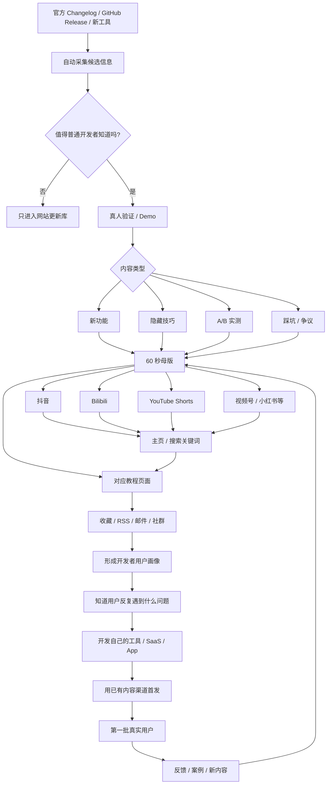

# 开发者工具短视频 IP 深度研究：成功样本、内容模板与九十天验证方案

## 执行摘要

**结论先说：这个方向值得做，而且最有价值的部分并不是“做一个程序员短视频账号”，而是建立一个“开发者工具变化情报 + 一分钟实测 + 可搜索知识库”的长期资产。**

从已经成功的开发者内容创作者看，这条路径并不是未经验证的假设。Coding with Lewis 官方称其内容已覆盖超过 120 万开发者；截至 2026 年 10 月，YouTube 约 75.9 万订阅。Matt Pocock 约 40.9 万订阅，而且过去 28 天仍增加约 2.6 万订阅；Fireship 已达到约 430 万订阅；ByteByteGo 约 143 万订阅。中国案例程序员鱼皮在其公开 GitHub 资料中称全网粉丝超过 200 万、内容播放破亿，同时已经把流量延伸到编程导航、面试鸭、AI 导航等十余个产品。也就是说，**“开发者内容 → 精准用户 → 自有网站/课程/软件产品”这条商业链条已经被多个不同类型创作者验证。** citeturn27search8turn23view1turn20view0turn30view1turn30view0turn30view3

更重要的是，这些案例显示，真正容易获得超额传播的开发者内容，并不一定是传统意义上的“系统教程”。Lewis 一条 **“WTF is going on at GitHub?”** 只有 1 分 17 秒，却取得约 42.1 万播放，是其频道常态的约 11.73 倍；Matt Pocock 的完整 AI Coding workflow 视频约 64.9 万播放；Fireship 关于 GPT-6 Astra 的快速解读在一个月左右达到约 424 万播放。**变化、争议、新工具、可以立刻改善工作流的技巧，比“从零学习 XX”更适合短内容。** citeturn25view0turn20view0turn30view1

但我也认为你最初设想中有一个危险点：

> **“介绍软件更新”本身不是护城河。**

AI 很容易总结 changelog，官方账号也能讲新功能。你的壁垒应该变成：

**发现 → 筛选 → 亲自验证 → 解释“为什么开发者应该关心” → 给出 30 秒可复现 Demo → 长期维护版本状态 → 建立可搜索数据库。**

换句话说，不应该把自己定位成：

> “每天告诉程序员有什么新闻的人。”

而应该逐渐形成：

> **“程序员不知道某个工具怎么用、最近变了什么、哪个功能值得用时，第一个想到来搜的人。”**

这和 ByteByteGo 把短而易传播的视觉内容沉淀成结构化文字课程、Matt Pocock 把 AI coding workflow 沉淀成 AI Hero，以及程序员鱼皮把公开视频连接到 CodeFather、AI Guide 和自研软件的路径非常相似。 citeturn27search7turn27search1turn30view3

我对这个项目的综合判断是：

| 维度 | 判断 | 原因 |
|---|---:|---|
| 用户需求 | ★★★★★ | AI 时代开发工具和工作流变化极快 |
| 内容供给空间 | ★★★★☆ | 英文很多，中文“高密度 + 持续实测 + 索引化”仍有差异空间 |
| 短视频适配性 | ★★★★★ | 一个功能、一个技巧、一个结果天然适合 30–90 秒 |
| 用户商业价值 | ★★★★★ | 开发者天然是 SaaS、API、云服务、AI 工具高价值用户 |
| 内容制作难度 | ★★★☆☆ | 找题容易，真正验证和保持正确性比较耗时 |
| 可复制风险 | ★★★★☆ | 单条视频非常容易被模仿 |
| 长期护城河 | ★★★★☆ | 前提是积累网站数据库、搜索流量、品牌与用户关系 |
| 与你未来自研软件协同 | ★★★★★ | 这是这个项目最大的潜在价值 |
| 我是否建议做 | **建议做** | 但先用 90 天验证，不应该一开始重投入 |

最值得你注意的一个数据，是 Matt Pocock：截至本次抓取约 40.9 万订阅，但过去 28 天增加约 2.6 万；其当前爆款内容高度集中在 **AI coding、agent skills、开发工作流**。这说明到 2026 年，这个题材并没有因为内容增多而彻底失去增长空间。 citeturn20view0


## 创作者样本、规模与近三个月表现

### 数据口径说明

以下数据以 **2026 年 10 月 16 日**为观察点。订阅与播放量会不断变化，因此应理解为抓取快照而不是永久数字。YouTube 主频道数据主要使用频道公开页面与 vidIQ 的公开统计页交叉检查；商业模式尽量使用创作者自己的官网。vidIQ 的所谓“预估收入”并非创作者披露，因此我**不把它当作真实收入**，只用订阅、播放和 engagement 等可观察指标。 citeturn20view0turn23view1turn30view0turn30view1

另外，你要求“每人近三个月最近十条视频 + 点赞/评论/分享”。这里存在一个现实的数据问题：YouTube 匿名公开页面并不会稳定暴露历史 Shorts 的全部 engagement，尤其是 **share 数量基本不可公开取得**；B站和抖音匿名 Web 抓取更不完整。因此下面只写本轮研究能够可靠核验的指标，无法验证的项明确写“—”，而不是估算或编造。部分频道在过去 90 天公开索引到的作品本身也少于十条。

还有一点非常重要：**并非下面七个人现在都是严格意义的“60 秒 Shorts 创作者”。** 我把他们分为两类：

**直接模型**：Coding with Lewis、Matt Pocock，近期大量内容就在约 1–2 分钟；Hyperplexed 更偏极强视觉 Demo。

**方法论模型**：Fireship 现在很多视频约 5–6 分钟，Theo 甚至 20–40 分钟；ByteByteGo 也偏中短解释型内容。它们不适合照搬时长，但非常值得拆解“标题、Hook、信息密度、商业闭环、知识库”的方法。

### 创作者对比

| 创作者 | 主要平台 / 规模 | 当前可观察发布节奏 | 核心内容模型 | 商业化方式 | 对你的参考价值 |
|---|---|---|---|---|---|
| **Coding with Lewis** | YouTube 约 **75.9 万**；官网称跨 YouTube/TikTok/Instagram 覆盖 **120 万+开发者** | 最近 22 天至少 6 条，约每周 2 条 | 1–2 分钟开发者新闻、AI、软件历史、工具故事 | 品牌技术内容、赞助、广告；公开资料显示曾与 Supabase、Hostinger 等品牌合作 | **最接近你的模型** citeturn23view1turn27search8turn27search24 |
| **Matt Pocock** | YouTube **40.9 万**，近 28 天 +2.6 万 | 高频，有时集中连续发布多条 | AI coding workflow、Claude/Agent Skills、极具体工程技巧 | AI Hero、Total TypeScript 等付费课程 + 内容 | **“一个小技巧就是一条视频”的最佳样本** citeturn20view0turn27search1turn27search9 |
| **Fireship** | YouTube **430 万**；近 28 天约 2489 万播放 | 2026/10/1–10/15 至少 7 条，约 3 条/周 | 超快技术新闻、热点、Demo、讽刺幽默 | Fireship Pro、课程、YouTube、赞助 | **最佳节奏/Hook教材** citeturn30view1turn28search0 |
| **ByteByteGo** | YouTube **143 万**；近 28 天约 129 万播放 | 相对低频，偏精品 | 动画图解、系统设计、AI/工程概念 | 付费知识库、课程、订阅、赞助 | **最佳“视频→网站知识库”模型** citeturn30view0turn27search3turn27search7 |
| **Hyperplexed** | YouTube **65.7 万**；累计约 1.05 亿播放 | 低频、作品型 | Web/UI 效果 Demo、纯视觉冲击 | YouTube 等内容收入；本轮未找到清晰的一方付费产品页面 | **最佳视觉 Demo 模型** citeturn23view0 |
| **Theo – t3.gg** | YouTube **57.2 万**；近 28 天约 458 万播放 | 最近几乎日更，但现在主要是长视频 | 开发者新闻、AI、产品评价、直播评论 | 正式品牌赞助 + T3 自有产品 | **“媒体反哺自己软件”的重要模型，但不要照搬时长** citeturn20view1turn3search17turn18search3 |
| **程序员鱼皮** | 本人公开资料称**全网 200 万+粉丝、播放破亿** | 多平台运营；匿名抓取无法可靠计算近 90 天精确短视频频率 | 编程教学、AI 工具、项目、职业内容 | CodeFather、面试鸭、AI 导航等十余个自研产品 + 教程/书籍/商业服务 | **最重要的中国市场商业闭环案例** citeturn30view3 |

这里已经能看到一个很有意思的分化。

**Lewis 是“内容媒体型”；Matt 是“专家知识产品型”；Fireship 是“开发者媒体 + 教育公司型”；ByteByteGo 是“知识库型”；Theo 是“内容 + 自有软件型”；鱼皮已经接近“内容流量 + 产品矩阵型”。**

你真正应该组合的是：

> **Lewis 的选题 + Matt 的颗粒度 + Fireship 的节奏 + ByteByteGo 的网站 + 鱼皮/Theo 的产品商业闭环。**

而不是完整复制其中任何一个人。

### 近期视频数据：Coding with Lewis

Lewis 最近的作品尤其值得你研究，因为时长与你设想的“一分钟”最接近。其官网自称主要面向开发者与技术爱好者，而当前 YouTube 约 75.9 万订阅。 citeturn27search8turn23view1

| 发布时间 | 标题 | 时长 | 主要形式 | 播放快照 | 点赞 / 评论 |
|---|---|---:|---|---:|---:|
| 10/14 | **The BEST LLMs to run locally by device** | 1:02 | VO + 画面/工具比较 | 20.6K | 908 / 42 citeturn24view0 |
| 约 10/8 | **Is AI making developers slower?** | 1:03 | 观点 + 资料画面 | ≈22.2K | 737 / 48 citeturn24view0turn9view0 |
| 约 10/6 | **The most dangerous part about LLMs** | 1:19 | 观点解释 | ≈24.0K | 531 / 18 citeturn24view0turn9view1 |
| 约 10/1 | **The most controversial operating system ever** | 1:58 | 技术故事 | ≈121.4K | — citeturn24view0 |
| 约 9/29 | **How I accidentally destroyed the internet** | 1:13 | 第一人称故事 | ≈16.6K | 784 / 49 citeturn25view1 |
| 约 9/24 | **WTF is going on at GitHub?** | 1:17 | 热点/冲突/解释 | **420.9K** | **11.23K / 576** citeturn25view0 |

搜索索引中还能看到诸如 **“5 Agent Skills Every Developer Should Use”**、**“11 Lines of Code Broke the Internet”**、**“5 Things Developers Can Automate with AI #ad”** 等近期内容，但本轮公开抓取无法同时核验精确发布日期、时长和互动指标，所以不把这些数字补出来。 citeturn18search2

这里最值得研究的不是平均播放，而是异常值：

**“WTF is going on at GitHub?” 达到约 11.73× 频道常态表现。** citeturn25view0

为什么？

不是因为它比“最佳本地 LLM”技术更深，而是因为标题同时满足：

> 我每天都用 GitHub  
> + GitHub 好像出事了  
> + 我不知道发生了什么  
> + 只需要一分多钟就能搞懂

这就是你这个 IP 最值得复制的心理模型。

### 近期视频数据：Matt Pocock

Matt 当前约 40.9 万订阅，近 28 天新增约 2.6 万；这在成熟开发者频道中属于非常明显的增长。其内容已经高度转向 AI coding 与 agent workflow。 citeturn20view0

| 发布时间 | 标题 | 时长 | 形式 | 播放快照 |
|---|---|---:|---|---:|
| 10/14 | **Mutation testing is AWESOME** | **0:58** | talking head + 工程概念/Demo | ≈57.3K；较早快照 996赞/22评 citeturn20view0turn22view0 |
| 约 10/14 | **Tell your agents to CARE about the codebase** | 2:06 | 工程技巧 + Demo | ≈47.7K citeturn22view0 |
| 约 10/14 | **/retro is a banger of a skill** | 1:03 | Agent Skill Demo | ≈5.6K citeturn22view0 |
| 约 10/14 | **STOP running your checks in harness hooks** | 1:31 | 反常识工程建议 | ≈16.8K citeturn22view0 |
| 约 10/14 | **Your skills are WAY TOO LONG** | 1:34 | 错误→正确 | ≈9.8K citeturn22view0 |
| 约 10/14 | **Your effort level is STILL TOO HIGH** | 1:15 | 错误→优化 | ≈23.1K citeturn22view0 |
| ≈3个月 | **mattpocock/skills: A complete AI Coding workflow, end-to-end** | 长内容 | 完整 workflow Demo | **649.5K** citeturn20view0 |
| ≈3个月 | **/wayfinder: Nothing is too big to plan anymore** | 长内容 | Agent workflow | **595.0K** citeturn20view0 |

Matt 的真正启发是：

> **不要总是介绍整个软件。介绍软件中的一个“动作”。**

例如：

不是：

> Claude Code 完整教程。

而是：

> “你的 Agent Skill 写得太长了。”

不是：

> AI 编程最佳实践。

而是：

> “别再把 checks 放进 harness hook 里。”

这种题目**天然适合 60 秒**。

而且 Matt 并没有停留在流量：他的官网现在直接把这些实践沉淀为 **AI Hero**，此前还经营 Total TypeScript 等完整付费知识产品。 citeturn27search1turn27search9

### 近期视频数据：Fireship

Fireship 已有约 **430 万 YouTube 订阅和 7.76 亿累计播放**；最近 28 天仍有约 2489 万播放。 citeturn30view1

近期主频道已经从经典“100 Seconds”扩张为约 5–6 分钟的快速新闻，因此**不要复制时长，要复制压缩能力和包装方式**。

| 日期 | 标题 | 时长/形式 | 可见表现 |
|---|---|---|---:|
| 10/15 | **The runtime wars are over... and Node won** | 5:40；VO+B-roll+代码+梗 | ≈708K+ citeturn30view1turn6view1 |
| 10/14 | **OpenAI’s lead engineer was secretly a spy...** | 5:06；事件叙事 | ≈1.34M citeturn19search11turn6view1 |
| 10/12 | **Every app on Earth is now open source... whether it likes it or not** | 5:56；故事+Demo | ≈3.74M citeturn19search4turn6view1 |
| 10/7 | **A $6.3 billion open-weight model just got embarrassed by the French...** | 6:10；比较/冲突 | ≈1.53M citeturn19search2turn6view1 |
| 10/5 | **PewDiePie is setting AI free... and OpenAI is furious** | 5:46；人物+冲突 | ≈2.58M citeturn19search7turn6view1 |
| 10/1 | **The one OpenAI announcement that can actually make you money...** | 5:47；发布会总结 | ≈1.83M citeturn19search0turn6view1 |
| 9/30 | **Did a 50 year old military secret just solve agent prompt injection?** | 快速解释 | 公开索引未可靠取得快照指标 citeturn19search0 |
| 9/28 | **DHH has gone completely off the rails...** | 新闻/观点 | — citeturn19search6 |
| 9/25 | **Meta is pivoting again... everything you missed from Connect 2026** | 发布会压缩 | — citeturn19search1 |
| 9/21 | **An ex-OpenAI researcher just deleted language from the LLM...** | 新技术解释 | — citeturn19search8 |

另外两条尤其值得你的选题系统学习：

Fireship 9 月 7 日做 **“Big AI wants you broke... here are some free alternatives”**，一次介绍 Ollama、9router、Headroom、Diffy、OpenHands 五个降低 AI coding 成本的工具，据该索引记录，视频上线两小时即超过 7.2 万播放。 citeturn19search3

9 月 9 日，他让两个新模型**完成同一个游戏任务再直接比较结果**；索引记录前三小时已超过 11.7 万播放。 citeturn19search10

这两个模式特别适合你：

> **省钱型选题。**

以及：

> **同一个任务，两个工具谁做得更好。**

### 其他样本的关键近期信号

Theo 目前约 57.2 万订阅，但最近内容大多已经是 18–48 分钟：Gemini 4 测试约 21.5 万播放；“Meta just caught up with Anthropic”约 15.7 万；“I thought AI was gonna get cheaper?”约 13.1 万；“You can rewrite TypeScript in Rust for $420k”约 16.9 万；“finally a good small model”约 16.6 万；“Does the $200 Codex plan suck now?”约 16.5 万。两个月前 **“So I tried Matt's skills...”** 达到约 49.7 万。Theo 不是你的时长标杆，但说明 **“我替你试了”** 是很强的开发者内容定位。 citeturn22view1turn20view1

ByteByteGo 当前约 143 万订阅；2026 年 10 月 8 日的 **“How to Test Your Code (Even When AI Writes It)”** 在约五天时已达到约 6.82 万播放、2.28× outlier。其长期高播放作品包括 Kubernetes Explained ≈194 万、REST API ≈147 万、SSL/TLS/HTTPS ≈130 万、Kafka ≈124 万。这证明另一种内容也成立：**把复杂工程概念压缩成一个极清楚的视觉模型。** citeturn30view0

Hyperplexed 当前约 65.7 万订阅，其历史爆款 **“Award Winning Animation With Only 20 Lines Of CSS?”** 达到约 221 万播放；“If Pixar Made Programming Tutorials”约 69.1 万。它的关键不是新闻性，而是**第一秒就能看到最终效果**。 citeturn23view0

程序员鱼皮的公开资料尤其值得你研究商业化：他明确列出 CodeFather、面试鸭、老鱼简历、AI 导航、剪切助手、算法导航、代码小抄等多个自有产品，同时维护 AI Guide 等免费内容资产，其 AI Guide 已覆盖 AI 工具、Vibe Coding、Agent Skills、RAG、MCP、AI 编程等内容。这几乎就是“免费内容建立人群 → 自有产品矩阵”的中国版本。 citeturn30view3


## 高互动视频的共同模式与可复制方法

### 什么内容最容易产生超额播放

把上面的异常值放在一起，规律其实非常明显。

| 模式 | 典型例子 | 为什么容易传播 | 适合你的程度 |
|---|---|---|---:|
| **正在发生的大变化** | “WTF is going on at GitHub?” ≈42.1万、11.73× | 已有巨大用户基数 + FOMO + 直接影响工作 | ★★★★★ citeturn25view0 |
| **新东西 + 极端结论** | “Did OpenAI actually build AGI?” ≈424万 | 用户已经知道事件，但不知道该怎么判断 | ★★★★★ citeturn30view1turn19search13 |
| **同任务 A/B 实测** | Astra vs Fable，同一个游戏 | 无须理解 benchmark，直接看结果 | ★★★★★ citeturn19search10 |
| **立刻能改善工作流** | Matt AI Coding Skills / Wayfinder | 看完可以马上安装、配置、复制 | ★★★★★ citeturn20view0 |
| **我替你试过了** | Theo “So I tried Matt's skills...”≈49.7万 | 节省用户试错时间 | ★★★★★ citeturn20view1 |
| **省钱 / 免费替代** | Fireship 免费 AI 工具合集 | 直接量化用户收益 | ★★★★★ citeturn19search3 |
| **视觉 WOW** | Hyperplexed 20 行 CSS ≈221万 | 不需要解释就能理解价值 | ★★★★☆ citeturn23view0 |
| **复杂知识极简化** | ByteByteGo Kubernetes ≈194万 | 收藏价值高、搜索寿命长 | ★★★★☆ citeturn30view0 |
| **技术争议/人物故事** | DHH / GitHub / OpenAI | 冲突带来天然叙事 | ★★★★☆ citeturn19search6turn25view0 |
| **“你一直做错了”** | “Your skills are WAY TOO LONG” | 对现有行为提出挑战 | ★★★★★ citeturn22view0 |

所以你未来的内容数据库不应该按照：

> VS Code  
> GitHub  
> Codex  
> Cursor

这么简单分类。

还应该按照**传播动机**分类：

> 新变化 / 隐藏功能 / 省时间 / 省钱 / 替代方案 / 踩坑 / 实测 / 对比 / 自动化 / 争议 / 安全问题 / 工作流。

这会直接改善你的选题系统。

### 一分钟视频最值得采用的节奏

从 Lewis 和 Matt 当前的 58 秒–1 分 30 秒内容，以及 Fireship 的压缩方式看，我建议你的标准模板定成：

| 时间 | 内容 | 目标 |
|---:|---|---|
| **0–3 秒** | 直接展示结果或冲突 | “为什么我要继续看？” |
| **3–8 秒** | 一句话解释原来的痛点 | 建立相关性 |
| **8–15 秒** | 告诉用户这个功能是什么 | 不讲历史 |
| **15–38 秒** | 实际屏幕操作 / Demo | 核心价值 |
| **38–48 秒** | Before → After | 让价值可感知 |
| **48–54 秒** | 一个限制/坑 | 建立可信度 |
| **54–60 秒** | 网站 CTA | 把流量变成资产 |

例如不要这样开始：

> “大家好，我是 XXX，今天给大家介绍 Codex 最近更新的一个新功能……”

前五秒已经浪费了。

应该直接：

> **“Codex 这个新功能，可以让它自己检查刚刚写坏的代码。”**

同时屏幕直接出现结果。

然后：

> “以前你得让它写完，再手动跑测试；现在……”

**先价值，后名字。**

这正是 Lewis 的 GitHub 标题、Matt 的“STOP…”、“WAY TOO LONG”，以及 Fireship 大量“某件事刚刚发生了”的共同逻辑。 citeturn25view0turn22view0turn19search0

### Hook 最值得建立成模板库

建议至少建立六类 Hook：

**信息差：**

> “Codex 更新了这个功能，但官方 changelog 里很多人直接略过了。”

**损失厌恶：**

> “你每天都在用 Git，但这个操作可能一直多做了三步。”

**反常识：**

> “AI 写代码，不一定会让开发更快。”

这个主题本身已经出现在 Lewis 最近内容中。 citeturn9view0

**替用户试错：**

> “我把同一个 bug 同时给 Codex 和 Claude Code，结果差距比我想的更大。”

**结果先行：**

> “这个网页动画只有 18 行 CSS。”

Hyperplexed 的历史爆款已经验证了这种包装的传播能力。 citeturn23view0

**变化警报：**

> “GitHub 今天改了一个东西，做开源项目的人最好知道。”

### 视觉上不要“讲软件”，而要“让软件自己表演”

最值得复制的不是满屏字幕，而是：

**鼠标动作 + 局部放大 + 快速切换 + 前后结果。**

一条视频最好只有一个视觉主线。

例如：

```text
错误代码
   ↓
Codex / Claude Code 执行
   ↓
出现一个关键功能
   ↓
修复结果
```

而不是：

```text
人脸
↓
讲 15 秒
↓
PPT
↓
再打开软件
```

对于开发者内容，**真正的 Demo 本身就是 B-roll。**

### CTA 不应该主要是“求关注”

用户已经看了一个有用功能，再喊：

> “关注我，每天学习编程知识。”

信息价值非常低。

你的 CTA 应该成为第二次价值交付：

> **“完整命令、版本号和配置我放到了主页教程页，以后版本变了我也会在那里更新。”**

或者：

> **“这个功能还有三个参数，一分钟讲不完，主页搜 `Codex Worktree`。”**

这就同时完成：

**短视频 → 网站 → 搜索习惯 → 回访用户。**

ByteByteGo 将视频风格的视觉解释继续沉淀成文字课程和插图式内容；Matt 也把 agent skills 做成可安装、可继续学习的网页资源，这种“短内容只是入口”的结构与你的目标高度吻合。 citeturn27search7turn27search5


## 三十个适合你的一分钟选题

下面不是随机列 30 个“程序员知识点”。我按你未来最可能形成 IP 的方向排序。

评分：

**易做度**：越高越快制作；  
**新奇度**：普通程序员“不知道”的概率；  
**传播潜力**：是否容易产生点击、收藏、分享；  
**P0**：第一批就应该测试；P1：第二批；P2：补充内容。

发布前，涉及具体版本和新功能的题目都应该重新检查官方 changelog，而不要仅依赖二手消息。

| 优先 | 一分钟选题 / 标题方向 | 易做 | 新奇 | 传播 |
|---|---|---:|---:|---:|
| **P0** | **“Codex 今天更新的这个功能，到底有什么用？我实际跑一遍”** | 5 | 5 | 5 |
| **P0** | **“同一个 Bug：Codex vs Claude Code，谁先修对？”** | 4 | 5 | 5 |
| **P0** | **“GitHub 刚改了什么？60 秒只讲跟开发者有关的部分”** | 5 | 5 | 5 |
| **P0** | **“这个 Claude Code Skill 我用了以后，Agent 终于不乱改代码了”** | 4 | 5 | 5 |
| **P0** | **“你每天用 VS Code，但这个功能大概率没点过”** | 5 | 4 | 5 |
| **P0** | **“AI 编程最浪费钱的一个操作，改掉它能少烧很多 Token”** | 4 | 4 | 5 |
| **P0** | **“Git 有个后悔药：代码删了还能这样找回来”** | 5 | 3 | 5 |
| **P0** | **“我把同一个需求交给三个 AI Coding Agent，结果是……”** | 3 | 5 | 5 |
| **P0** | **“别再手动开三个项目目录：Git Worktree + AI Agent 这样用”** | 4 | 5 | 5 |
| **P0** | **“新 AI 编程工具爆火，我只测一个问题：能不能替掉 Cursor/Codex？”** | 3 | 5 | 5 |
| **P0** | **“这个开源工具能替代一个我每月付费的软件吗？”** | 4 | 5 | 5 |
| **P0** | **“官方 changelog 只有一句话，但这个更新其实很重要”** | 5 | 5 | 5 |
| **P1** | “Claude Code / Codex 的上下文为什么越来越慢？一分钟看懂” | 4 | 4 | 5 |
| **P1** | “MCP 和 Skills 到底有什么区别？不要再混着用了” | 4 | 4 | 5 |
| **P1** | “AI 写完代码以后，我只做这三个检查” | 5 | 3 | 5 |
| **P1** | “Mutation Testing 是什么？为什么普通测试全过也可能有 Bug？” | 4 | 4 | 4 |
| **P1** | “Chrome DevTools 这个功能，可以直接重放刚才那个请求” | 5 | 4 | 4 |
| **P1** | “调接口别急着写代码：浏览器里先做这一步” | 5 | 3 | 4 |
| **P1** | “你的 Terminal 其实可以搜索几个月前敲过的命令” | 5 | 3 | 4 |
| **P1** | “Docker 构建慢？先看这个缓存到底有没有命中” | 4 | 3 | 4 |
| **P1** | “一个命令找遍百万行代码：为什么开发者喜欢 ripgrep” | 5 | 3 | 4 |
| **P1** | “jq 这个小工具，可能省掉你写一段 Python” | 5 | 3 | 4 |
| **P1** | “Git bisect：不用一条条翻提交，也能找到哪个 Commit 搞坏了项目” | 4 | 4 | 4 |
| **P1** | “AI 自动改代码前，先让它生成这个东西” | 4 | 4 | 5 |
| **P2** | “一台普通电脑到底适合跑什么本地模型？” | 3 | 3 | 5 |
| **P2** | “三个我用了很多年才发现的 VS Code 快捷操作” | 5 | 2 | 4 |
| **P2** | “今天发现一个只有 XXX MB 的开发工具，却能替代……” | 4 | 4 | 4 |
| **P2** | “这个 GitHub 开源项目昨天突然爆火，它到底解决什么？” | 4 | 4 | 5 |
| **P2** | **“程序员今天值得知道的三个更新，只讲有用的”** | 5 | 4 | 5 |
| **P2** | **“一周开发工具更新：我替你看完 100 条 changelog，只留这 5 条”** | 3 | 5 | **5** |

最后两类非常重要。

因为长期做下去以后，你可以形成一个很明确的品牌承诺：

> **“你不用每天刷 Hacker News、GitHub、Product Hunt、X、官方 Changelog，我替你看。”**

这才真正对应你最初提出的“信息爆炸”问题。

而且建议内容比例不要完全跟新闻走。我的初始配比会是：

**40% 新变化 / 30% 隐藏功能与效率技巧 / 20% 实测比较 / 10% 开发者故事与争议。**

这样既有增长，也有长期搜索价值。


## 脚本模板、拍摄剪辑与网站承接

### 模板：新版本隐藏功能

**0–3 秒**

> “Codex 刚加的这个功能，我觉得比发布会上讲的东西更实用。”

画面：直接展示最终结果。

**3–10 秒**

> “以前你让 Agent 做完这个任务之后，还得自己 XXX。”

画面：旧流程，2–3 个操作。

**10–18 秒**

> “现在打开这里 / 输入这个命令……”

画面：局部放大操作。

**18–38 秒**

> “我给它一个真实项目试一下。”

画面：实际运行，不要解释界面所有元素。

**38–48 秒**

> “以前 4 步，现在 1 步，而且它还会 XXX。”

画面：Before / After。

**48–54 秒**

> “但是有个坑：XXX 情况下不要开。”

这是建立可信度最关键的一句。

**54–60 秒**

> “完整命令、版本号和失效情况我放到了教程页，主页搜『XXX』。”

### 模板：隐藏技巧

**0–3 秒**

> “你可能每天用 Git，但我赌这个功能很多人没用过。”

**3–10 秒**

直接制造问题：

```text
刚刚误删了文件
提交也没了
怎么办？
```

**10–15 秒**

> “不要重新写，Git 其实还记得。”

**15–38 秒**

屏幕录制完整操作。

**38–48 秒**

展示恢复结果。

**48–53 秒**

> “这个东西叫 reflog，它和普通 log 最大区别是……”

只解释一句。

**53–60 秒**

> “命令和另外两个恢复场景我整理在网站，搜 Git reflog。”

### 模板：工具 A/B 实测

**0–3 秒**

> “同一个 Bug，我同时给 Codex 和 Claude Code，看谁先修对。”

屏幕立即左右分屏。

**3–8 秒**

> “项目、Prompt、测试完全一样。”

**8–35 秒**

快速展示两个工具关键步骤。

不要把等待过程完整播出：

```text
A：分析 → 修改 → 测试
B：分析 → 修改 → 测试
```

**35–45 秒**

直接出结果：

```text
Codex     2m14s   8 files   ✅ tests
Claude    1m46s   3 files   ✅ tests
```

**45–53 秒**

> “但快的不一定更好。A 多改了 5 个不相关文件。”

**53–60 秒**

> “Prompt、仓库和完整 diff 都放到了测试页，下一期换另一个项目再测。”

注意这个 CTA 非常强。

因为它天然制造：

> **系列内容。**

### 推荐录制与剪辑 Checklist

| 项目 | 标准 |
|---|---|
| 开头 | 不出现 Logo 动画，不自我介绍 |
| 第一个有价值画面 | ≤1 秒 |
| Hook | ≤3 秒讲清利益或冲突 |
| 核心知识点 | **每条只讲一个** |
| 屏幕字体 | 手机屏幕仍能看清 |
| 鼠标 | 放大/高亮关键位置 |
| 画面变化 | 建议每 1.5–3 秒至少有轻微变化 |
| 字幕 | 只强调关键词，不把整段台词全塞到画面 |
| 空白 | 删除“呃”“然后”“我们来看一下” |
| Demo | 尽量使用真实项目 |
| 可信度 | 至少说一个局限/适用条件 |
| 声音 | 人声优先于背景音乐 |
| 结束 | 不做 5 秒结束动画 |
| CTA | 引导到一个具体教程，而非泛泛求关注 |
| 原素材 | 保存无字幕 16:9/9:16 母版，方便多平台重用 |

### 网站不要做成“博客”，而应该做成开发工具数据库

这是我认为你整个想法中**最有可能真正产生护城河的地方**。

每条视频自动对应一个 URL，例如：

```text
/tools/codex/
/tools/codex/worktree/
/tools/codex/xxx-feature/
/tools/vscode/xxx/
/tools/github/xxx/
```

每个页面固定包含：

| 字段 | 内容 |
|---|---|
| 功能 | 这个东西是什么 |
| 价值 | 它解决什么问题 |
| 视频 | 60 秒版本 |
| 适用版本 | Codex x.x.x / VS Code x.x |
| 更新时间 | 官方发布日期 |
| Last verified | 你最后一次实际验证的日期 |
| 操作步骤 | 3–7 步 |
| 命令 | 可复制 |
| Demo | GIF / 截图 |
| 注意事项 | 坑、限制、费用 |
| 官方源 | Changelog / Docs / Release |
| 相关教程 | 内链 |
| 替代方案 | 其他工具 |
| 状态 | Active / Deprecated / Changed |

**Last verified** 尤其重要。

因为 AI 时代最大的问题之一是：

> 搜到的教程已经过期，但用户不知道。

如果你的品牌能够做到：

> **“这个人网站里的教程都是验证过版本的。”**

这会比简单文章数量有价值得多。

ByteByteGo 的网站已经证明“简短社交传播内容 → 结构化图文学习资产”是可行的，其网站强调图解式文字课程，并销售长期访问；Fireship 也已经把免费内容进一步延伸成完整课程库。 citeturn27search7turn28search0

### 最终内容漏斗



这里最漂亮的地方，是最后会形成一个循环：

> **你做内容，是在发现需求。**  
> **你的网站，是在记录需求。**  
> **你做软件，是在解决已经验证过的需求。**  
> **你的受众，就是第一批用户。**

这比“先闭门开发一个 App，再想办法推广”合理得多。

程序员鱼皮公开资料列出的多个自研产品已经体现类似结构；Matt 也从教育内容延伸到 AI Hero，而 Fireship 的免费媒体最终连接到每年 495 美元的 Fireship Pro 课程库。 citeturn30view3turn27search1turn28search5

### 缩略图 / 首屏文字建议

不要：

```text
┌───────────────────────────┐
│ Codex 2026.10.15版本       │
│ 最新功能详细介绍及使用教程 │
│                           │
│       很多小字             │
└───────────────────────────┘
```

更接近：

```text
┌───────────────────┐
│   CODEX            │
│                   │
│  这个功能          │
│  没人讲？          │
│                   │
│ [真实界面截图]      │
└───────────────────┘
```

或者：

```text
┌───────────────────┐
│ Claude │ Codex     │
│        VS          │
│                   │
│ 同一个 BUG         │
│ 谁先修好？         │
└───────────────────┘
```

或者：

```text
┌───────────────────┐
│  4 步   →   1 步   │
│                   │
│ VS CODE            │
│ 隐藏功能           │
└───────────────────┘
```

可直接观察这些频道的视觉包装：

Coding with Lewis：  
https://www.youtube.com/@CodingWithLewis

Matt Pocock：  
https://www.youtube.com/@mattpocockuk

Fireship：  
https://www.youtube.com/@Fireship

ByteByteGo：  
https://www.youtube.com/@ByteByteGo

Hyperplexed：  
https://www.youtube.com/@hyperplexed

程序员鱼皮 Bilibili：  
https://space.bilibili.com/12890453

尤其值得同时对比 **Fireship 和 ByteByteGo**：前者用冲突、人物、夸张结论制造点击；后者更偏图解与知识卡片。你的品牌最好处在二者之间——**足够有吸引力，但不要失去工程师信任。** Fireship 当前的大量标题确实明显使用冲突型包装，而 ByteByteGo 的长期高播放内容则更多是直接的问题式解释。 citeturn19search0turn19search6turn30view0


## 九十天内容测试计划、KPI 与最低预算

### 前九十天不要把目标设成“成为大 V”

真正需要验证的是四件事：

**第一，能不能持续找到题。**

**第二，哪一种题程序员真的愿意看完和转发。**

**第三，用户会不会从短视频进入你的网站。**

**第四，你能不能通过这些人发现未来软件产品的需求。**

粉丝只是其中一个指标。

### 九十天测试设计

| 阶段 | 时间 | 内容量 | 核心问题 |
|---|---|---:|---|
| **探索期** | 第 1–4 周 | 20 条，5条/周 | 哪类内容有市场 |
| **聚焦期** | 第 5–8 周 | 20–24 条 | 找到 2–3 个稳定爆点模型 |
| **系统化期** | 第 9–13 周 | 25–30 条 | 能否形成内容→网站→订阅循环 |
| **90 天合计** |  | **约 65–74 条** | 决定是否扩大投入 |

这大约足以测试十余种 Hook、五六种内容类型和多个工具类别。

不要第一周发了五条只有几百播放就判断失败。

短内容存在很强的单条波动。Lewis 最近同一频道里，约 1 分钟的视频可以只有 1.66 万播放，也可以达到 42.1 万，后者是频道常态约 11.73 倍；Matt 最近几条也从约 5 千到近 6 万不等。**应该观察“模式是否可以重复”，而不是一条有没有爆。** citeturn25view0turn25view1turn22view0

### 每周固定栏目

我会先采用这样一个工作日节奏：

| 星期 | 栏目 | 示例 |
|---|---|---|
| 周一 | **这周更新了什么** | Codex / Claude Code / VS Code 新功能 |
| 周二 | **你可能不知道** | 隐藏功能 |
| 周三 | **我替你试了** | 新工具 / 开源项目 |
| 周四 | **A vs B** | 同一个任务比较两个工具 |
| 周五 | **一分钟省时间** | Git / Terminal / Browser / IDE 技巧 |
| 周六 | 网站整理 + 下周选题 | 不一定发视频 |
| 周日 | 数据复盘 | 找赢家，不追求发视频 |

这样用户慢慢就会知道：

> 周三可以来看新工具。  
> 周四可以看 AI 工具实测。

形成栏目比每天随机发“编程知识”更容易形成认知。

### 建议建立一个选题评分器

每个候选更新进入后台以后自动计算：

```text
Score =
用户覆盖面 × 25%
+ 新奇程度 × 20%
+ 实际节省时间 × 20%
+ 是否可视觉 Demo × 15%
+ 争议 / 意外性 × 10%
+ 搜索长期价值 × 10%
```

例如：

```text
Codex 某 UI 小改动
覆盖面       4
新奇度       2
省时间       1
Demo         3
争议         1
长期搜索     1
=> 不拍
```

而：

```text
GitHub 改变开发者日常 Workflow
覆盖面       5
新奇度       5
省时间       4
Demo         4
争议         5
长期搜索     4
=> 立即拍
```

这本身以后甚至可以做成你的内部 AI Agent：

```text
Changelog
    ↓
LLM 摘要
    ↓
用户价值评分
    ↓
自动生成候选标题
    ↓
你选择
    ↓
真人验证
```

**不要让 AI 代替最终验证。**

因为“我真的试过”恰恰会成为你的品牌价值。

### KPI 不要只看播放

以下数字不是所谓“行业平均水平”，而是我建议你给自己设置的**实验判断线**。

| KPI | 30 天目标 | 60 天目标 | 90 天意义 |
|---|---:|---:|---|
| 发布量 | ≥20 | ≥40 | ≥65 |
| 前 3 秒留存 | 尽量 ≥70% | 找到稳定 Hook | 保留赢家模板 |
| 60 秒完播 | 目标 ≥55–65% | ≥60% 的模板占主力 | 决定主时长 |
| 点赞+评+收藏+分享 / 播放 | 记录基线 | 优秀内容 ≥基线 1.5× | 形成题材评分 |
| 爆款 | 至少出现 2–3 个明显 outlier | 找到共同特征 | 证明不是偶然 |
| 网站点击 | 能测出来即可 | ≥0.3–1% 为实验目标 | 判断 CTA |
| 教程页收藏/订阅 | 开始出现 | 稳定出现 | 证明用户愿意离开平台 |
| 回访用户 | 建立基线 | 上升 | **最重要资产之一** |
| 搜索访问 | 少量即可 | 部分教程开始被搜到 | 验证知识库价值 |
| 用户提问 | 收集 ≥50 个 | 建需求库 | 为未来产品服务 |
| “能不能做个工具解决它” | 开始记录 | 分类 | **未来 SaaS 题库** |

其中我认为对你商业目标真正重要的排名是：

> **回访用户 > 网站用户 > 收藏/分享 > 评论 > 粉丝 > 点赞。**

一个有 10 万粉丝但用户不离开平台的账号，未必比一个有 2 万精准开发者、每月几千人主动访问网站的 IP 更有商业价值。

### 前三十天测试矩阵

不要连续发 20 条 Codex。

应该人为打散变量：

| 内容类别 | 数量 |
|---|---:|
| AI Coding 新功能 | 4 |
| Git / GitHub | 3 |
| VS Code / IDE | 3 |
| 新工具实测 | 3 |
| 隐藏功能 | 3 |
| A/B 比较 | 2 |
| 程序员效率小工具 | 2 |

同时测试 Hook：

```text
你不知道……
刚刚更新……
别再……
我试了一下……
A vs B……
只需要……
这个功能居然……
```

30 天以后就可以发现：

> **工具类型影响播放更多，还是 Hook 影响播放更多？**

这才是真正的数据驱动运营。

### 第二个月开始只放大赢家

例如 20 条以后发现：

```text
普通技巧        median 3,000 views
新功能          median 9,000
A/B 实测        median 18,000
GitHub事件      median 30,000
```

那么不应该继续平均分配。

应该把下一阶段调整为：

```text
35% A/B 实测
30% 开发者变化
20% 隐藏功能
15% Evergreen
```

就像 Lewis 的 GitHub 内容出现约 11.73× outlier，Fireship 的 GPT-6 Astra 达到数百万，而 Matt 的 agent workflow 明显成为频道增长核心一样，真正成功的频道通常会让观众逐渐清楚：

> **“我为什么要看这个人。”** citeturn25view0turn30view1turn20view0

### 最低可行预算

假设你已经有开发电脑和手机，我**不建议前三个月买昂贵摄影设备，也不建议投流。**

| 项目 | 最低方案 |
|---|---:|
| 域名 | 约 ¥50–100 / 年 |
| 网站 Hosting | 初期可用免费额度 |
| 录屏 | 免费工具即可 |
| 剪辑 | 免费工具即可 |
| 字幕 | 免费/低价 AI |
| 麦克风 | ¥200–600 一次性 |
| 灯 | 有需要再买，¥100–300 |
| 简单素材/图标 | ¥0–100/月 |
| AI API 自动整理 changelog | 初期约 ¥50–200/月即可控制 |
| 广告投流 | **¥0** |
| 90 天建议现金投入 | **约 ¥300–1,500** |

这个预算是我给这个实验设计的**经营假设**，不是市场报价标准。

真正最大的成本不是钱，而是：

> **每周 6–10 小时。**

前 10 条视频可能需要两三个小时一条。

做出模板后目标应该逐渐压到：

```text
找选题        10 min
实际验证      15–30 min
脚本          10 min
录制          10 min
剪辑          20–30 min
网站生成      5–10 min
```

也就是一条视频尽可能控制在 **60–90 分钟生产时间**。

网站文章绝对不要再人工重新写一次。

应该：

```text
一次研究
 ↓
结构化 Markdown
 ↓
生成 60 秒脚本
 ↓
生成字幕
 ↓
生成网站教程
 ↓
生成标题/描述
 ↓
多平台发布
```

真正需要你亲自投入的应该是：

> **判断什么值得讲 + 亲自验证。**

其他都尽量自动化。

### 九十天后的 Go / No-Go 标准

**强烈继续：**

出现至少 3 个可以重复的内容模型；不是某一条偶然爆，而是连续多个同类型题材都明显高于频道 median。

同时：

```text
短视频
   ↓
主页
   ↓
网站
```

已经能够稳定带来用户，而且有人主动：

> 收藏教程、搜索其他工具、问你某功能、建议你测试某软件。

这说明品牌开始成立。

**继续但调整：**

播放量不错，但网站没人点。

这说明你做成的是：

> 娱乐/资讯号。

还没有成为：

> 工具型品牌。

此时要加强：

**代码、配置文件、Prompt、完整对比数据、下载资源、Last Verified** 等只能在网站获得的价值。

**谨慎停止或大幅转向：**

65–70 条视频之后：

没有任何题材能稳定超过自己的基线；

用户很少收藏、提问；

网站基本没有回访；

你每条仍需要三四个小时；

自己也越来越不想研究这些工具。

那说明至少当前制作方式不存在正向飞轮，不应该因为已经投入时间就继续。

### 最终判断

这个项目真正的机会，不是复制：

> “iPhone 使用技巧。”

而是做成开发者世界里的：

> **“一分钟知道这个工具刚刚多了什么、值不值得用、怎么马上用。”**

从本次样本看，**开发者愿意消费这种高密度内容是已经被证明的**：Lewis 的 GitHub 变化视频只有 1 分 17 秒却产生约 42 万播放；Matt 的 AI coding workflow 形成持续高速增长；Fireship 可以围绕技术新闻持续创造百万级播放；ByteByteGo 则证明短解释最终能够沉淀为大型知识资产。 citeturn25view0turn20view0turn30view1turn30view0

而你的构想比单纯复制这些频道多了一层非常重要的东西：

> **你最终想卖的不是内容，而是自己开发的软件。**

这一点反而让我更看好这个方向。

因为最难的事情往往不是：

> “能不能把软件写出来？”

而是：

> **“软件写出来以后，谁知道它？”**

如果几年之后你手中拥有的不是一个依赖平台推荐的短视频账号，而是：

```text
几十万精准开发者关注
        +
几千篇持续更新的开发工具教程
        +
大量 Google / 百度 / Bing 搜索入口
        +
邮件 / RSS / 社群 / App 用户
        +
知道大家每天遇到什么问题的数据
        +
开发者对你“这个人真的会试工具”的信任
```

那么你再发布一个自己的开发者产品，冷启动难度和现在从零推广会完全不同。

Fireship 已经把媒体影响力延伸到每年 495 美元的课程体系；Matt 把专业内容延伸到 AI Hero 和 Total TypeScript；ByteByteGo 把免费内容延伸到付费知识产品；程序员鱼皮公开列出了十多个自有项目。**内容本身可以赚钱，但更大的价值是降低以后每一个产品的获客成本。** citeturn28search5turn27search1turn27search9turn27search32turn30view3

所以我的客观结论不是简单的“做短视频可行”，而是：

> **值得做，但从第一天就应该把它当作“开发者用户基础设施”来建设，而不是自媒体副业。**

最合理的长期资产结构是：

**一分钟视频负责发现你；  
网站负责让用户再次找到你；  
数据库负责建立护城河；  
持续实测负责建立信任；  
最终软件负责真正商业化。**

在这个模型里，**粉丝不是终点，而是未来所有软件产品的第一批分发渠道。**