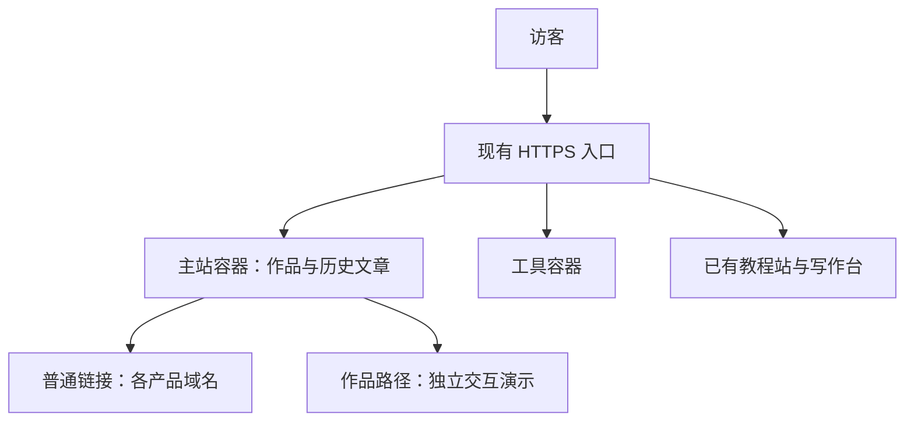

# 官网架构调整与服务器迁移

日期：2026-10-24。状态：主站与工具已迁移到 `101.96.210.172`，正式域名 DNS、HTTPS 新证书、续期演练和公共入口验收均已完成。服务器受限发布链路已实际通过，但新 GitHub Actions 流程尚未提交、推送或由 GitHub runner 运行。教程独立域名尚未启用，旧服务器仍有独立演示、媒体及其他产品依赖；各阶段证据和真实限制见文末实际部署记录。

## 已确认的方向

- 主站和工具迁往用户本次指定的 `101.96.210.172`。主站一个容器，工具一个容器；其他产品各自部署，主站菜单或产品入口通过普通链接跳转相应域名。
- 主站以作品展示为主：主页展示领域能力 → 领域作品列表 → 具体作品详情或交互展示。已有直接进入演示的卡片不强制再经过介绍页。
- 主站的“文章”入口改为个人教程 IP 入口。“文章暂时不要”按撤下主入口处理，保留历史文章内容、原 URL、RSS 和现有提交后自动发布能力。
- 教程 IP 沿用已有项目，不另起一套内容系统。`my-ip/WEBSITE.md` 已指向本仓库的 [IP 项目入口](dev-guides/README.md)；网站和写作台位于 `apps/dev-guides/`。
- 保留 HR 灯塔 Logo、备案页脚、真实项目资料和首页已有的响应式约定。未提供公开案例的领域继续显示真实空状态。

本次新服务器要求覆盖旧文档对**主站和工具迁移目标**的记录。已有政企领域页和汽车采样站是独立部署，仍遵守 [完整部署交接文档](enterprise-demo-deployment.md) 的正式路径与数据边界；不能仅因主站迁移就擅自改变它们的路径或移动服务。

## 已批准并实现的架构

主站采用 **Astro + TypeScript + 静态生成 + Nginx 容器**，实现位于 `apps/site/`。页面正文、作品信息、导航与链接在构建时生成 HTML；现有 Vue 概念图静态渲染，首页背景按需加载 Vue 交互岛，主题和菜单使用少量原生 JavaScript。主站不需要数据库或常驻 Node 服务。`apps/blog/` 保留为 VitePress 历史文章兼容构建，与 Astro 产物合入一个镜像。

[Astro 默认预生成静态页面](https://docs.astro.build/en/guides/on-demand-rendering/)，[交互岛](https://docs.astro.build/en/concepts/islands/)允许只为需要交互的区域发送客户端组件。选择它的原因是作品站的页面组织和视觉自由度，以及与已有教程站共享维护经验。[VitePress 也能生成静态 HTML](https://vitepress.dev/guide/deploy)，不能把换框架本身当成 SEO 改善的证据；本次 SEO 验收依据初始 HTML、canonical、sitemap、真实路由和历史地址兼容。

| 部分 | 职责与部署 | 访问方式 |
| --- | --- | --- |
| 主站 | 一个 Nginx 容器；Astro 公开页面，构建时加入历史文章静态产物 | `https://herong.info/` |
| 工具 | 沿用现有 Next.js 单容器，镜像含 FFmpeg，持久数据独立挂载 | 本次保留 `https://herong.info/file-tools` 编译时路径；独立域名根路径另行重构建与验收 |
| 教程 IP | 沿用 Astro 公开站及独立写作台、内容存储和发布流程 | 当前 `https://101.96.210.172/dev/`；目标 `https://dev.herong.info/` 尚待启用 |
| 自营产品 | 各产品独立部署、独立发布 | 使用各自已确认的域名，集中配置入口 |
| 作品交互演示 | 按项目保留独立运行服务与资源 | 现有正式作品路径继续有效 |
| HTTPS 入口 | 复用新服务器已有主机 Nginx，按域名和既有路径分流 | 独立正式 server 与局部 snippet，不覆盖 IP 根站、教程或其他产品 |

“主站一个容器、工具一个容器”描述这两个应用的部署边界，不表示整台服务器总共只有两个服务。教程写作台、其他产品及带后端的演示仍有各自的运行与数据需求。

## 主站入口与内容

当前主站导航为：**主页、教程、工具、自营产品、关于**。

- 首页沿用已确认的五个作品领域，第六张卡片已改为“开发工具教程”，指向已有教程 IP。导航和卡片已与 [首页规范](homepage.md) 同步。
- 领域列表沿用 `/projects/<领域标识>/`，具体作品沿用 `/projects/<领域标识>/<项目标识>/`，不新增 `fields` 或 `apps` 层级。
- 作品详情提供可公开且有依据的场景、本人承担的工作、关键实现和素材。可交互演示直接承载详情时，不增加强制的中间介绍页。
- 自营产品入口按产品跳转独立域名；保留现有 `/products/` 作为产品目录和旧地址兼容入口。菜单与目录从同一份配置读取，未上线产品如实标记状态。
- 工具域名、教程地址、产品域名统一从配置读取。跨站跳转使用带真实 `href` 的链接，不使用 iframe 或把所有应用拼成一个前端运行时。
- 迁移前已存在的扁平作品地址应列出映射；已有内容优先保留，确需改址时逐条配置永久重定向，不能统一跳回首页。

### 教程 IP 的实际资产

定位是面向中文开发者的开发工具功能演示与可搜索完整教程，短视频作为可选引流入口。策划、来源、选题在 `docs/dev-guides/`，公开站与写作台在 `apps/dev-guides/`。

根据仓库部署记录，正式/测试 IP 入口及写作台分别是 `/dev/`、`/test-dev/`、`/dev-admin/`。本次迁移后已重新核验这三个既有入口均为 `200`；没有重新验收写作台登录后的全部编辑发布流程。主站复用现有内容与发布流程，不把教程写作台塞进主站容器，也不让主站镜像覆盖线上文章。

`dev.herong.info`、`test-dev.herong.info` 仍是文档中的待启用域名，按 [教程架构文档](dev-guides-architecture.md) 的接入条件处理。IP 预览和测试环境继续禁止索引；主站菜单在域名启用前只能使用真实可访问入口。

## SEO 与历史内容兼容

[Google 建议让主要内容通过服务端渲染或预渲染交付](https://developers.google.com/search/docs/crawling-indexing/javascript/javascript-seo-basics)。实施时以实际 HTML 与抓取结果验收，不能保证收录或排名。

1. 首页、领域页、作品详情的主要文字与链接直接出现在初始 HTML 中；动画或 3D 初始化失败也不隐藏全部作品信息。
2. 每页配置独立标题、描述、H1、HTTPS canonical 与分享信息，提供真实内容对应的结构化数据和 sitemap。只列出存在且开放索引的正式地址。
3. 缺失页面与静态资源返回真实 404，不能把任意地址以 200 返回首页。现有文档曾记录 HTTP canonical 和 soft-404 问题，迁移时需重新核验并修复。
4. 迁移服务器时尽量保留域名和路径；旧文章 URL 不批量跳转到首页或教程站，不能把两种不同内容等同处理。
5. Astro 页面与 VitePress 历史产物在构建阶段按明确路由清单合并进同一主站镜像。主站负责新首页及作品路由，历史构建只提供需要保留的文章和资源；合并时发现路径冲突就失败，不能用覆盖复制决定归属。RSS、文章搜索所需资源和旧链接一并验证。
6. GitHub Pages 现有 `/blog/` 发布能力保留；正式域名与备份站的 canonical 策略在迁移中明确，不能无意产生两套互相冲突的规范地址。

本地实现已修复 VitePress `transformHead` 对不存在的 `pageData.path` 的读取，改用 `relativePath`，避免文章 canonical 回落到首页。URL 辅助函数统一处理 `SITE_URL` 与 `BASE`，并对旧 GitHub Pages `/blog` + `/blog/` 配置加入回归验证，避免重复路径。主站合并产物保留 3022 篇历史文章，已核验新旧页面 canonical、sitemap、RSS、初始 HTML 及本地资源；含单引号等标点的旧文章路径保留原地址。正式入口的 HTTP、重定向和浏览器结果见下面实际部署记录。

## 代码与发布边界

继续使用当前 `code/` pnpm workspace，不移动根目录资料。已新增 `apps/site/` 承载 Astro 主站，保留 `apps/blog/` 为历史文章兼容构建；工具和教程目录沿用现状。`pnpm build:site` 依次执行检查、VitePress 兼容构建、Astro 构建、明确路由归属合并与产物校验，输出 `apps/site/dist-bundle/`。`pnpm dev` 默认启动主站，`pnpm dev:blog` 仍可独立开发历史站；检查、测试和命令见 [代码工作区说明](../README.md)。

每个应用独立构建、版本和发布。主站及工具分别有独立 Compose 配置、镜像标签及回滚版本；构建优先在本机或 CI 完成，避免服务器承担整仓构建。

原 `.github/workflows/deploy.yml` 的 `master` 提交后发布及 GitHub Pages `/blog/` 能力保留。当前工作区已将默认目标改为 `container-production`，并记录 `production-target=101.96.210.172`；`legacy` 与 `build-only` 仍可显式选择，新生产 CI 不承担 IP 预览部署。旧 rsync 限制为旧主机与 `/var/www/herongsite/`，正式容器目标通过 `site-ci` 受限身份上传静态归档，由服务器固定发布器激活。当前源码尚未提交或推送，不能据此宣称 GitHub Actions 已完成切换或验收。说明见 [主站发布文档](../infra/site/README.md#自动发布切换) 与 [受限发布说明](../infra/site/CI.md)。不能把独立服务的数据或产物塞入旧 rsync 目录。

工具当前生产 Compose 只有 `web` 服务，镜像已包含 FFmpeg，不需凭旧规划文档额外引入 PostgreSQL、Redis 或 worker。迁移应备份并恢复真实数据卷、会话配置和必要的私有配置；从 `/file-tools` 改为独立域名根路径时，必须重新构建 Next.js 的 basePath，并验证旧地址、下载、登录及已启用的支付回调。不能只改反向代理地址。

## 迁移顺序与验收

1. **核对与备份。** 只读盘点新旧服务器的服务、域名、端口、磁盘和容器卷；保存当前主站与工具版本、配置和数据。特别保护新服务器已有教程正式站、测试站、写作台及其持久内容。
2. **先完成本地改造。** 构建 Astro 主站，接入真实作品、教程与产品入口；完成历史 URL 清单、产物合并和新旧发布产物验证。容器端口在核对服务器后选定，不抢占已有服务。
3. **先在新服务器验证。** 上传版本化镜像，部署主站与工具；使用隔离预览入口验证，预览禁止索引。HTTPS 入口只增加本应用必要规则，不整体覆盖服务器 Nginx。
4. **保全既有作品路径。** 主站域名切向新服务器会连带影响 `/projects/enterprise/` 及采样站 API/SSE。切换前须完成这些路径的明确承接方案与端到端验证。不能只让首页通过就切换域名，也不能因此擅自迁移原 Java/H2 服务。
5. **核验域名启用条件。** 按既有教程部署记录核对新服务器的域名接入条件、证书与续期；就绪后配置正式域名，校验 HTTPS、canonical、重定向与 sitemap。未就绪时继续隔离预览。
6. **切换并保留回滚。** 使用与目标发布绑定的 CI 配置及版本化镜像，核验新服务器后再切换流量；旧服务器和配置暂留可恢复状态。迁移窗口协调发布，避免旧流程继续覆盖线上或工具数据出现分叉。
7. **最后处理旧服务器退役。** 旧 ECS 仍承担 `media.herong.info` 的 TOS 证书续期；跨云账号的身份权限与续期迁移尚待完成。该依赖验证前不能把旧服务器直接关停。图片桶与原云账号按既有决定继续保留。

验收覆盖主页 → 各领域 → 作品 → 返回、工具真实转换与下载、教程搜索与写作发布、每个已上线产品外链、旧文章抽样与 URL 清单、RSS、备案、移动端和明暗主题。另验证真实 404、静态资源、API/SSE、容器重启后数据、一次自动发布及各应用独立回滚。

## 本地实现与部署记录边界

2026-10-24 已完成本地实现：Astro 的 15 个正式页面及 404、VitePress 历史文章兼容构建、显式路由合并、SEO 与资源验证、主站独立镜像 / 回滚配置，以及工具独立迁移脚本。Astro 主要内容在初始 HTML 中，首页八种视口尺寸与窄屏内页已做浏览器检查。没有为未公开领域补造案例，也没有改变教程内容或独立演示的部署身份。

实际部署结果按下面的证据逐项记录；本地通过不代替线上验收，服务器受限发布成功也不代替 GitHub Actions 运行记录。旧服务器退役和媒体证书续期仍遵守上面的独立边界。

## 2026-10-24 实际部署记录（已完成正式域名切换）

用户已确认域名接入备案完成并授权切换。正式 `herong.info` 与 `www.herong.info` 的两条 A 记录已改为 `101.96.210.172`，两台权威 DNS 与本地解析均已核对为新地址。浏览器实际访问 `https://herong.info/` 已加载 Astro 主站，标题为“何荣 · 技术落地的不同现场”；桌面截图保存在 `output/playwright/site-live-desktop.png`，控制台 `0` 错误、`0` 警告。新服务器 Let's Encrypt 证书已安装对外使用，续期 dry-run 已成功。

### 主站版本与受限发布

- 新服务器：`101.96.210.172`；主站容器与 Compose 项目均为 `herong-site`，仅通过回环 `127.0.0.1:24380` 提供入口，容器内 Nginx 为 `8080`。
- 当前受限发布 release：`887b34c4a7c944a2e04fc666aae815a43a75be0b-2026102401-3`；本地记录为 `code/output/site-migration/ci-release.txt`。对应版本镜像名为 `herong-site:<release-id>`，服务目录按 `/opt/herong-site/releases/<release-id>/` 组织，`current` 指向当前版本。本次为释放磁盘清理了未实际接流量的旧候选镜像，现场不存在可用的主站 `previous`，不能照一般模板直接宣称有上一容器版本可切回。
- 当前已核验的主站 `buildId` 为 `cb50d8cea8b82b70`，容器健康。新版本已实际通过服务器 `site-ci` 受限身份的上传、固定发布器构建和健康激活链路；发布器只接收静态归档，不接受上传的脚本、Compose 或任意 Docker 命令。权限和归档限制见 [受限发布说明](../infra/site/CI.md)。
- 本地工作流默认已改为 `container-production`，目标标记为 `101.96.210.172`，但这次受限链路验收不代表 GitHub runner 已执行：当前本地实现仍有未提交改动，新 GitHub Actions 流程尚未推送或运行。release 名中的 commit 前缀只是本次发布标识，不能证明所有当前实现已包含在该 commit 中。启用后的真实 workflow run 及 `master` 自动发布结果须另行记录。

### 历史地址、定向预检与公共入口验收

- `code/output/site-migration/old-route-comparison.json` 对比旧站 `3041` 个 HTML 地址，结果 `missing: []`；其中 `3030` 个仍有对应静态产物，`11` 个由明确的作品 / 领域重定向承接。旧地址没有批量重定向回首页，`3022` 篇历史文章源码继续保留。
- `code/output/site-migration/preflight.json` 记录初次 `34` 项预检；后续 `pre-dns-full.json` 将工具健康和重定向链加入，共 `38` 项通过。两份记录均以正式 `https://herong.info` 为 origin、定向连接 `101.96.210.172`，属于切 DNS 前的目标入口验收；公共解析的切换另外按上面的权威与本地 DNS 检查确认。
- 切换后的 `code/output/site-migration/public-final.json` 未指定连接 IP（`connectIP: null`），正式域名公共入口的 `38` 项检查全部通过；实际 HTTPS 请求的 `remote_ip=101.96.210.172`，TLS 校验结果为 `0`（验证成功）。因此不只是 hosts / `--resolve` 定向测试成功。
- 主站首页、五个领域、六个作品详情、关于、自营产品、历史文章样本、归档、RSS、sitemap、robots 和以 `.js` 结尾的历史文章均得到预期 `200`；六个旧扁平作品入口得到 `301`。不存在页面、缺失 Astro JS 与 `/404` 得到真实 `404`。
- 采样站 `/api/system/info`、`/api/stations` 与真实 station ID 的 snapshot 均经正式项目路径得到 `200`；同一项目路径下的 SSE 在初次预检收到 `12` 个 `snapshot` 事件，完整 `38` 项预检收到 `13` 个。领域目录、采样站前端及 Java/H2 模拟服务继续在旧服务器独立运行，新服务器只按完整正式路径转发，未改为根 `/api`。
- `/projects/enterprise/enterprise-platform/` 由更精确的主站 location 承接，不会被独立政企领域应用吞掉；公共入口中的采样站 API / SSE 同样通过，收到 `13` 个 snapshot 事件。
- `code/output/site-migration/existing-services.json` 验证原 IP 根站与 `/dev/`、`/test-dev/`、`/dev-admin/` 均仍为 `200`。`http://herong.info/` 和 `https://www.herong.info/` 均按预期 `308` 到正式 HTTPS 主域名，没有覆盖既有 IP 应用或教程入口。

### 工具与回滚边界

工具继续单个 Next.js + FFmpeg 容器，保留 `/file-tools` 编译时路径。`code/output/site-migration/tools-migration-receipt.txt` 已记录最终迁移：

- release：`20261024T075359Z-final`；新机数据卷：`herong-light-tools-data-20261024T075359Z-final`。
- 沿用核验过的原镜像 `sha256:ff137343c228a2b9330afcb9e81ab9ddc853d6d25421b01d66002d1685e968f6`，没有在此次搬迁中引入工具业务或数据库格式升级。
- 旧机一致性备份：`/var/backups/herong-light-tools-migration/final-20261024T075359Z-final`；新机备份：`/opt/herong-light-tools/backups/20261024T075359Z-final`。
- 旧工具容器已停止，旧 `/file-tools` 入口桥接到新 `101.96.210.172`，避免 DNS 缓存窗口两端同时写入。旧数据与备份保留；若新端已有写入，回切前须先处理最新一致性数据，不能直接恢复较旧备份。

执行者已在正式公共 HTTPS 入口实际完成 `1` 秒 MP4 转 GIF 的上传、转换和下载，输出 GIF 为 `1151` 字节，结果保存在 `output/playwright/tool-live-conversion.gif`。工具容器重启前后核对的 `2` 个持久化文件共 `110151` 字节，检查摘要 `0c5aa13b21b5a9033e69cf86667e0f306237856651e8f88e9b62bb74e985484b` 一致；重启后健康检查仍为 `true`。这些证据覆盖本次转换和持久化样本，不等同于已验收所有账号、会员或支付回调。

工具保留原应用重定向行为：`/file-tools` 以 `307` 转到 `/file-tools/tools` 并返回 `200`；`/file-tools/` 以 `308` 规范到 `/file-tools`。边缘已取消与该行为冲突的补斜线规则，修复循环。新旧入口都保持完整 `/file-tools` 前缀，旧工具只桥接新机，没有双端写入。

入口配置依据 `infra/site/nginx/` 的独立 snippet 和现有主机 Nginx 增补；新机正式 server 使用 `/etc/nginx/conf.d/herong.info.conf`，工具、主站、政企与 SSE 分流保持各自边界。最新 LE 证书配置安装前的入口备份为 `/var/backups/herong-site/20261024T083555Z-edge.OYE7GZ`。

当前主站回滚基线是旧 `115.190.214.176` 的 legacy 静态站及切换前 DNS 目标，旧站目录 `/var/www/herongsite/` 保留；需要回退时分别处理主站 A 记录和入口配置，不能调用不存在的主站 `previous`。主站回退不改变工具单写归属：旧机 `/file-tools` 仍应转发新机。若确需把工具执行端迁回旧机，须先对新主数据做最新一致性备份，并按独立恢复方案写入合适的空卷，不能直接启动旧工具和旧卷。

### 新证书与续期

新服务器已实际完成 Let's Encrypt `certonly` 签发并安装，证书与私钥位置分别为 `/etc/letsencrypt/live/herong.info/fullchain.pem`、`/etc/letsencrypt/live/herong.info/privkey.pem`，证书到期时间为北京时间 `2027-01-22 15:36:29`（证书 notAfter 为 `Jan 22 07:36:29 GMT 2027`）。公网对外证书的 SHA256 指纹为 `F1:66:43:D8:46:54:7A:69:10:51:18:00:38:FE:36:2E:90:09:3C:AC:21:E9:61:6A:2C:1C:E7:F9:1D:E6:9D:D4`，TLS 信任校验已通过。

已实际运行并通过 `certbot renew --cert-name herong.info --dry-run --non-interactive --no-random-sleep-on-renew`。复用新机已有、处于 active 的 `ask-around-cert-renew.timer`，每 `6` 小时执行现有 renew-all 并 reload Nginx，没有另建重复 timer；旧机 `media.herong.info` 的续期依赖仍未迁离。

### 容量与剩余限制

- 本次新服务器剩余磁盘约 `1.2GB`、使用率约 `97%`，不足以视为长期发布容量充裕。后续发布按固定发布器的磁盘门槛拒绝低空间操作，不自动清理其他项目；当前没有新机主站 `previous`，运维回滚基线是上述旧站 / DNS，不能因此宣称常规双版本容量已经满足。
- 旧 `115.190.214.176` 仍承担政企 / 采样站 3D 服务、`media.herong.info` 的证书续期以及其他产品依赖，本次不得退役。旧工具的停机和数据主副关系以最终工具回执为准。
- 新 GitHub Actions 流程尚未提交或推送，尚无本次 GitHub runner 运行记录；源码推送后仍须核验一次真实生产 workflow 和 `master` 自动发布。已完成的是服务器 `site-ci` 受限发布，不把它写成 GitHub Actions 成功。
- `dev.herong.info`、`test-dev.herong.info` 尚未启用，教程继续使用真实 IP `/dev/` 入口；本次未重验所有教程写作、工具账号 / 会员或支付回调，不虚报这些业务验收。
